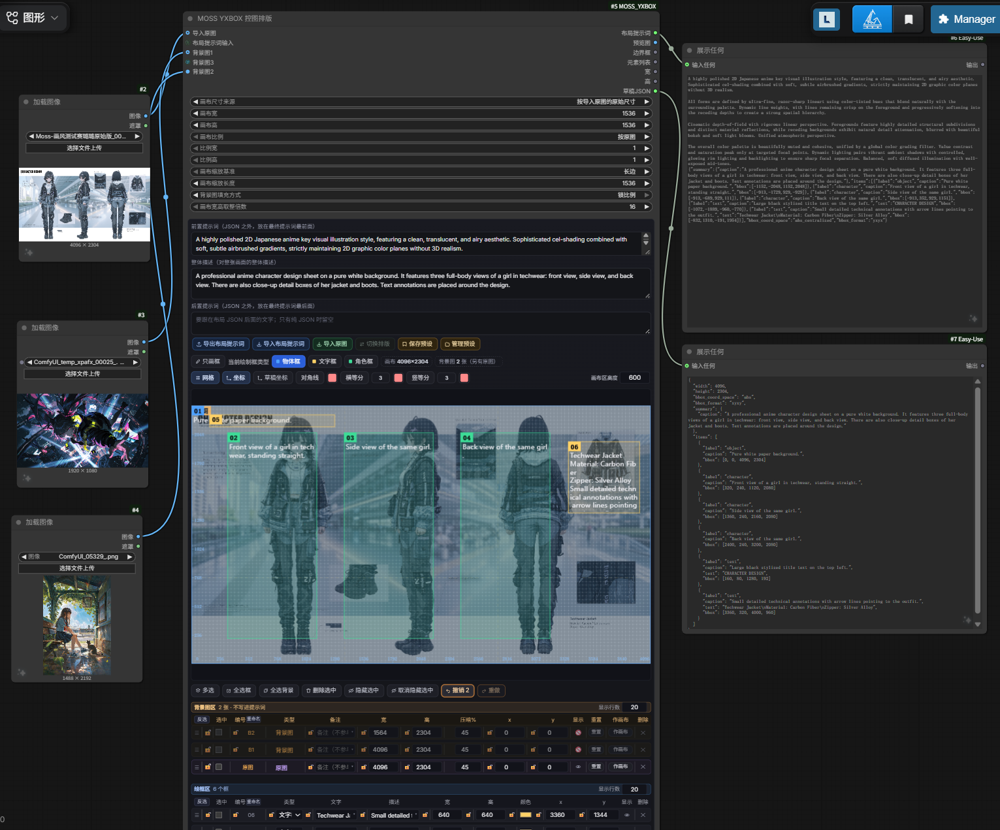

# MOSS YXBOX 控图排版

[](LICENSE)
[](https://github.com/liangci-ai/MOSS-YXBOX/releases)
[](https://github.com/liangci-ai/MOSS-YXBOX)
[](https://github.com/liangci-ai/MOSS-YXBOX/stargazers)
[](https://github.com/liangci-ai/MOSS-YXBOX/issues)



> **版本说明**：`main` 分支始终是**最新可用版**（= 最近一次 Release + 之后陆续的小修），小修复不会为此单独发版本号；GitHub 上的 tag / Release 是**里程碑快照**。想拿到最新修复，把节点更新到 `main` 即可（ComfyUI Manager 会提示）。

把 ComfyUI 官方的 **「Create Bounding Boxes」** 与 **「MOSS-Image Layout Prompt」** 合成 **一个** 中文节点，配一块能直接拖的布局画布：

- **一块画布装下所有框**：物体框 / 文字框 / 角色框画在同一块画布上，16 像素点阵 + 吸附，可滚轮缩放、右键平移。
- **逐行列表**：每个框一行，直接改类型、文字、描述、宽高、主色、x / y；每个参数带小锁，支持多选、拖拽排序、撤销重做。
- **背景图最多 64 张**：接图自动当画布背景并压暗，逐张可拖、缩、调层、填满画布；「导入原图」还会把 PNG 里记录的工作流布局读回来。
- **四种画布尺寸来源**：自定义 / 按缩放规则 / 按导入原图的原始尺寸（精确不取整）/ 按某张背景图的原始尺寸（按倍数取整）。**画布上显示的尺寸就是出图尺寸。**
- **提示词整套走**：前置提示词 + 布局 JSON + 后置提示词；布局提示词导入 / 导出与官方逐字节一致，另给一路带画布宽高的 `草稿JSON`。
- **两套坐标显示**：默认左下原点、y 向上；「草稿坐标」切到官方草稿的左上原点、y 向下，导入导出不受影响。

参数名与悬停说明全中文。下面按「安装 → 界面 → 参数 → 用法 → 输出」逐段讲，细节都在对应小节。

## English overview

**MOSS YXBOX** merges ComfyUI's official **Create Bounding Boxes** and **MOSS-Image Layout Prompt** nodes into a single Chinese-language node with a full layout workbench: one canvas for object / text / character boxes, 16 px grid with snapping, per-box rows (type, text, description, w, h, color, x, y) with parameter locks, multiple background images layered under the boxes, four canvas-size modes (the canvas size shown is the output size), pre/post prompt slots, and import/export of the layout prompt. Output JSON matches the official node byte-for-byte (`abs_centralized` + `yxyx`).

Install: copy this folder to `ComfyUI/custom_nodes/MOSS_YXBOX`, restart ComfyUI, hard-refresh the browser. Requires a ComfyUI build that ships the MOSS-Image nodes.

---

## 一、安装

把本文件夹放到：

```
ComfyUI/custom_nodes/MOSS_YXBOX
```

最终结构：

```
MOSS_YXBOX/
├── __init__.py
├── nodes.py
├── pyproject.toml      # ComfyUI Registry / Manager 用
├── README.md
├── LICENSE
├── docs/
│   └── preview.png     # README 顶部那张截图
└── web/
    └── moss_yxbox.js
```

也可以用 Manager 或在 `custom_nodes` 里执行：

```bash
git clone https://github.com/liangci-ai/MOSS-YXBOX.git
```

（文件夹名保持 `MOSS-YXBOX` 或改成 `MOSS_YXBOX` 都行，**唯一的硬要求是名字里不能有空格**，原因见下面的提示。）

然后 **重启 ComfyUI**，浏览器里按 `Ctrl + F5` 硬刷新。

节点位置：右键菜单 → `MOSS` → **MOSS YXBOX 控图排版**。

> **文件夹名必须没有空格。** ComfyUI 用 `web.static('/extensions/' + 文件夹名, …)` 提供前端脚本；文件夹名带空格时这条静态路由会 404（实测：脚本出现在 `/extensions` 列表里，但请求返回 404），结果就是节点上既没有画布也没有类型选择器。所以目录叫 `MOSS_YXBOX`，节点显示名仍是中文的「MOSS YXBOX 控图排版」。

---

## 二、界面从上到下

```
┌──────────────────────────────────────────────────────────────┐
│ ○ 导入原图                                                      │  ← 接图像：读图里的工作流信息，自动导入布局 + 把图放成列表里的「原图」那一行
│ ○ 布局提示词输入                                                │  ← 接文本，实时导入（下面的说明见「布局提示词输入口」）
│ ○ 背景图1   ○ 背景图2 …（最多 64 个背景图输入口，接一个自动长下一个）│  ← 图像输入口
├──────────────────────────────────────────────────────────────┤
│ 画布尺寸来源 │ 画布宽 │ 画布高 │ 画布比例 │ 比例宽/高 │ 画布缩放基准 │ 画布缩放长度 │ 背景图填充方式 │ 画布宽高取整倍数 │
├──────────────────────────────────────────────────────────────┤
│ 前置提示词（JSON 之外，放在最终提示词最前面；小斜杠可拖高度）            │  ← 参数下方
│ 整体描述（对整张画面的整体描述；右下角两条小斜杠可上下拖动改高度）      │  ← 参数下方、按钮上方
│ 后置提示词（JSON 之外，放在最终提示词最后面；小斜杠可拖高度）            │  ← 整体描述下方
├──────────────────────────────────────────────────────────────┤
│ [导出布局提示词] [导入布局提示词] [导入原图] [切换排版] [保存预设] [管理预设] │  ← 画布区正上方
├──────────────────────────────────────────────────────────────┤
│ 只画框  当前绘制框类型：[物体框] [文字框] [角色框]  画布 1536×1536  背景图 2 张 │
├──────────────────────────────────────────────────────────────┤
│ 网格 坐标 草稿坐标 对角线 横等分〔3〕竖等分〔3〕                        画布区高度〔600〕 │  ← 工具条（第二行）
├──────────────────────────────────────────────────────────────┤
│                                                              │
│        画布（16 点阵 + 三分线 + 等分线 + 坐标刻度 + 框 + 背景图）│
│                                                              │
├──────────────────────────────────────────────────────────────┤
│ 多选  全选框  全选背景  删除选中  隐藏选中  取消隐藏选中  撤销  重做 │
├──────────────────────────────────────────────────────────────┤
│ 背景图区 2 张 · 不写进提示词                              显示行数 [20] │  ← 背景图区标题行
│ 反选 ☑ 编号  类型  备注  宽  高  压暗%  x  y  显示 重置 作画布    删除 │  ← 背景图表头
├──────────────────────────────────────────────────────────────┤
│ ☰ 🔒 ☑ B1  [背景图]  🔓[备注]🔻 宽 高 [45] x y 👁 重置 ✕        │
│ ☰ 🔒 ☑ B2  [背景图]  🔓[备注]🔻 宽 高 [45] x y 👁 重置 ✕        │
│ ☰ 🔒   原图  [原图]    🔓[备注]🔻 宽 高 [45] x y 👁 重置 ✕        │  ← 导入原图进来的那张（紫色底，不占 B 号）
├──────────────────────────────────────────────────────────────┤
│ 绘框区 6 个框                                            显示行数 [20] │  ← 绘框区标题行
│ 反选 ☑ 编号  类型  文字  描述  宽  高  颜色  x  y  显示            删除 │  ← 绘框区表头
├──────────────────────────────────────────────────────────────┤
│ ☰ 🔒 ☑ 01  🔓[类型▾] 🔓[文字]🔻 🔓[描述]🔻 宽 高 色 x y 👁 ─ ✕   │
│ ☰ 🔒 ☑ 02  🔓[类型▾] 🔓[文字]🔻 🔓[描述]🔻 宽 高 色 x y 👁 ─ ✕   │
├──────────────────────────────────────────────────────────────┤
│ MOSS YXBOX v1.0.4 · 框 6 / 背景 2      画布 1536×1536 · 缩放 260% · 网格 16 │  ← 底部状态栏（只读）
└──────────────────────────────────────────────────────────────┘
```

表头与下面的行使用同一套盒模型（同样的 `padding`、`border`、`box-sizing`）和一个 22 列网格，所以每一列的标题都正对着下面那一列的内容。

**列表分两块，背景图在上、绘框在下**：

- **背景图区**（橙色调）：一行标题写着「背景图区 N 张 · 不写进提示词」，这一行最右边是背景图区的**显示行数**；下面单独一行表头（选中 / 编号 / 类型 / 备注 / 宽 / 高 / **压暗%** / x / y / 显示 / 重置 / 作画布 / 删除），再下面才是背景图行；没有接入背景图时整块自动收起，不占高度。**最新接进来的那张图永远排在列表最上面**，画布上也在所有背景图的最上层。
- **绘框区**（蓝色调）：一行标题写着「绘框区 N 个框」，这一行最右边是绘框区的**显示行数**；下面单独一行表头（选中 / 编号 / 类型 / 文字 / 描述 / 宽 / 高 / 颜色 / x / y / 显示 / 删除），再下面是框行。**「重置 / 作画布」只有背景图才有，绘框区没有这两列**；两区每行的**第二个格子都是整体锁**（紧挨拖拽手柄 ☰）：点一下这一行所有字段全锁上（图标变 🔒），再点一下全解开，**只锁状态，绝不改这张图的位置和尺寸**。表头里原来那些「锁」字小标题已经去掉（只留那一格的位置），锁的图标和功能都没动，鼠标停在那一格上仍有说明。背景图区把原来的「颜色」列换成了**压暗%**：1~100 的整数，可以手输也可以点上下箭头（步长 1），数值越大背景越暗（默认 45），这个百分比会写进画布数据，重新打开工作流还在，预览图里也按这个比例逐层压暗。

两块各用自己的一套列宽网格（各 22 列），表头与下面的行仍然逐列对齐。

两块的行各自拖拽排序，互不干扰；在某一区拖动 `☰` 只会在该区内部换顺序。

列表显示行数**两个区各管各的**，互不影响：

- **背景图区**标题行最右边、**绘框区**标题行最右边各有一个**显示行数**输入框，默认都是 **20**；只能填从 0 开始的整数，填 0 就只剩那一个区的表头。
- 这里数的「行」只算本区下面**带编号的行**（B1、B2… 或 01、02…）；两个区的**标题行**和**表头**（一共四行）永远显示，**不算**在显示行数里，也不会被藏掉。
- 实际行数少于等于这个数字时，全部显示、不留空行（例如 8 个框就显示 8 行）；超过时只露这么多行，剩下的用滚轮在**这个区里**往下滑。
- 填的数大于等于实际行数时，就等于「显示全部行」。
- 两个数字分别存在节点里（`yxBgRows` / `yxBoxRows`），下次打开工作流还是它们；改大之后界面会跟着变高，节点不够高时会一次性撑到刚好够用（只加不减，不会动你自己拉的尺寸）。
- 列表高度不再跟节点拉长 / 缩短联动；右下角那个拖行数的手柄也已经去掉。
- **两个区各自滚动**：鼠标在哪个区里滚动就只滚那个区，两个区不会互相带着走；行高按实测的 34px 计算（不是早先写死的 32px），所以填「20」就真能看到 20 个完整行，最后一行不会再只剩半截。
- 列表行里 **宽 / 高 / x / y** 四个数字框的列宽从一开始就有 62px，数字框自带的**上下小箭头保留**（可以点箭头微调数值）、内容居中，箭头和四位数同时放得下；节点拉宽后它们跟着等比变宽。为了让位给四个数字列，**文字 / 描述**两列的最小宽度相应收窄，每个锁图标也各占 14px 独立一列——所以数字框变宽不会再把锁 / 颜色这些图标挤扁或叠在一起。

### 画布区（绘图区）的尺寸

- **宽度**：拉宽节点，画布区跟着变宽，可绘制 / 可操作的范围一起变大。
- **高度**：默认 **600px**（v1.0.4 起；想回到按窗口自动算的 180–520px，就把输入框清空）。
  想手动指定高度，就用**画布上方第二行工具条最右边的「画布区高度」输入框**（字号比周围的标签略大）：清空＝自动；填数字＝固定成这个高度（140–2600px），值存在节点里、跨会话保留。填得比节点剩下的空间还高时，节点会**一次性**被撑到刚好装下（只加不减，之后不会再动节点尺寸）。
  注意：拉长 / 缩短节点**都不会**改变画布区高度，只会改变节点本身的空白。
- 画布本身仍是固定长宽比，居中显示；画布区多出来的空间就是可以平移 / 缩放的画布范围，滚轮缩放（100%–800%）与右键拖动平移照旧。

**滚轮归属**：鼠标在背景图区里滚轮只滚背景图区、在绘框区里只滚绘框区——滚动是脚本自己算的（`scrollTop += deltaY`），所以在 Nodes 2.0 那种会吞掉滚轮事件的前端里也照样能滚；不会把整个工作流视图缩放掉。在描述框里滚轮只滚描述框；**在列表行的文字 / 描述 / 备注输入框里点开三角弹出的大输入框里滚轮，只滚那个大输入框自己**，不会带着列表一起滚；在画布上滚轮是缩放画布（100%–800%）；在画布以外的地方滚轮照常缩放工作流视图。

### 按键分组、颜色与图标

按键按「这一排是干什么的」分组配色，同一类永远是同一个色相；图标只是辅助区分，鼠标停在任何按钮上都有完整中文说明。

| 分组 | 按键 | 配色 | 图标 |
| --- | --- | --- | --- |
| 布局提示词（蓝色组） | 导出布局提示词 / 导入布局提示词 | 深蓝底 + 蓝描边 + 浅蓝字 | 出框箭头 / 入框箭头 |
| 原图（绿色组） | 导入原图 / 切换排版 | 深绿底 + 绿描边 + 浅绿字 | 入框箭头 / 双向箭头 |
| 预设（琥珀组） | 保存预设 / 管理预设 | 深琥珀底 + 琥珀描边 + 米黄字 | 书签 / 文件夹 |
| 绘制框类型 | 物体框 / 文字框 / 角色框 | 按钮左侧常驻一个**本类型的小色块**：蓝 / 金 / 绿（与画布上框的颜色一致，选中时才整块变蓝） | — |
| 工具开关 | 只画框 / 多选 / 网格 / 坐标 / 草稿坐标 | 平时中性灰，打开时变偏蓝 | 铅笔 / 图层 / 网格 / 坐标轴 |
| 历史 | 撤销 / 重做 | 琥珀色描边（与其它组一眼区分） | 左弯箭头 / 右弯箭头 |
| 危险 | 删除选中（以及行内删除） | 平时灰，鼠标移上去才转红；点第一次进入「确认删除」变实红 | 垃圾桶 |
| 选择类 | 全选框 / 全选背景 / 隐藏选中 / 取消隐藏选中 | 中性灰，作用于全部时变偏蓝；「取消隐藏选中」在选中的对象里有隐藏项时点亮 | 虚线框+勾 / 叠层图 / 闭眼 |

图标全部是内联 SVG（用 `currentColor` 做遮罩），不加载任何外部图片，也不改按钮里的文字——所以「撤销 3」「取消全选框」这类会变的文字照常工作。

### 底部状态栏

节点最底部固定一条只读状态栏，用一条细分隔线与列表区分开，列表滚到底也不会再像「被切断」：

```
MOSS YXBOX v1.0.4 · 框 6 / 背景 2        画布 1536×1536 · 缩放 260% · 网格 16
```

- **左侧**：插件版本号 · 当前框数 / 背景图张数
- **右侧**：画布尺寸 · 画布缩放百分比 · 网格状态（`网格 16` 或 `网格 关`）

它只是显示，不能点击，也不会改变任何数据；数字跟着画布与列表自动刷新（隐藏的框也算在「框」的数量里，因为它仍然在这份布局里）。

状态栏下面另外留了 21 px 的内边距（节点高度的预算里再多留 38 px）：经典画布渲染（关掉 Nodes 2.0）会把 DOM 控件最底部裁掉十几个像素，留出这段空白后状态栏就不会再被切掉。

### 导入原图（画布区正上方，位置在「导入布局提示词」与「切换排版」之间）

选一张 **PNG 原图**，插件会做两件事：

1. 读图里带的文件信息（ComfyUI 存进去的 `prompt` / `workflow` 等文本块），把生成这张图时用的布局提示词找回来：框、类型、编号、文字、描述、「整体描述」一起还原。
2. 把这张图放成背景图列表里那一行 **「原图」**（它有自己的身份：不占 `背景图N` 编号、不抢背景图输入口、列表里用紫色底区分），并把「画布尺寸来源」自动切成 **按导入原图的原始尺寸** —— 画布＝这张图的像素宽高，**精确到像素、不取整**（1000×1500 就是 1000×1500），图按原比例撑满画布、居中。所以导入完就能直接拿这张图当基准微调框。

- **不要求工作流里有本插件的节点**：只要那张图的工作流里，某个节点的文本参数里带着**带 `bbox` 的布局 JSON**（顶层 `items` / `summary.items` / `elements` / `boxes`、编译格式 `abs_centralized` + `yxyx` 都认），就能导入。扫描范围是整份 `prompt`（API 格式）和 `workflow`（界面格式）里所有字符串参数，以及图里其它文本块。
- **只认真正参与出图的那份**：插件会先从 `/保存/预览/导出` 这类终点节点沿连线往回走（API 格式看 `inputs` 里的连线数组，界面格式看 `links` 表，被静音的节点不计入），算出这次跑图真正用到的节点集合。布局 JSON 出现在这个集合里，才标「✔ 参与出图」；放在没接上的旧节点、静音节点里的，标「未参与出图」。只有一份「参与出图」的候选时直接导入，不弹菜单；有多份（正向/反向、二次采样）才让你挑。
- **图里没有布局 JSON、只有自然语言提示词时也能导入**：生成这张图用的那段提示词会直接放进「整体描述」，一个框都不生成（图照样放成「原图」那一行、画布照样按原图尺寸）。也就是说不管当初是「反向反推出布局」还是「普通文生图」，导入都不会报错。
- 图里有多份布局数据时，菜单列出「来源节点（类型） · 框数 · 画布尺寸 · 是否带整体描述」，排序是：参与出图的 → **画布比例最接近这张原图**的（同一张图常存了好几份排版，比例对得上的才是这张真正用的）→ 带描述的 → 框多的，点一份即导入。
- 只认写进图里的文本：图片被压缩/转存工具抹掉文件信息、格式不是 PNG（如 JPEG / WebP 不带这些文本块）时，仍然会把这张图放成「原图」那一行、画布按原图尺寸，只是没有框/描述可导。
- 图里的布局数据不止一份时，会弹出和「导入布局提示词」同款的列表让你挑；挑完之后这张图的候选一直记着，想换另一份**不用再选文件**，点旁边的「切换排版」即可（见下一节）。
- **图片地址不会写进画布数据**：从文件选的图在页面里是临时地址（`blob:`），插件存 `画布数据` 时会把这类临时地址清掉，只保留能在 `/view?…` 取到的地址。这样重开工作流不会出现「莫名其妙多出一张别的图」的残留。
- 这张图打不开（文件被删、格式不认）时，插件会把「原图」那一行的图清空并提示，不会让上一张旧图留在画布上冒充当次导入的结果。
- 导入算一步操作，可以按「撤销」回到导入前。

### 切换排版（绿色组，在「导入原图」右边）

- 只有在「这张原图里找到多份布局数据」时才亮起来，否则是灰的（鼠标停上去会说明为什么灰）。
- 点它不用重新选文件：把**当前这张原图**里的候选排版列出来，换一份就立刻重新铺一遍（框、「原图」那一行、画布尺寸来源照旧按原图）。
- 通过左侧 `导入原图` 输入口自动导入的那张图，同样可以用这个键换排版。

### 导入 / 导出布局提示词（画布区正上方两个按钮）

| 按钮 | 作用 |
| --- | --- |
| 导出布局提示词 | 弹窗显示节点**最终会输出的那段布局提示词**（与后端编译结果逐字一致，含 `summary` / `items` / `bbox_coord_space` / `bbox_format`），只读，点「复制」即可拿走。没有画任何框时，导出的是「整体描述」原文，和节点输出一致。 |
| 导入布局提示词 | 弹窗粘贴一段内容，点「导入」就能还原画布。三种内容都认：①草稿（`items` 里是 `bbox` 加 `bbox_origin`，或 `x/y/width/height`）；②编译后的布局 JSON（`bbox_coord_space: abs_centralized` + `bbox_format: yxyx`，中心原点）；③纯描述文字（只写进「整体描述」）。带 ```` ```json ```` 代码块、带前后说明的整段 LLM 回答也能直接粘。元素列表除了顶层的 `items`，也认写在 `summary` 里的 `summary.items` / `summary.elements`（有的模型会把 items 塞进 summary；插件自己导出的写法是顶层 `items`），还认 `compositional_deconstruction.elements`、`elements`、`boxes`；描述除了 `summary.caption` / `caption`，也认 `high_level_description` / `description`；草稿里没写 `width/height` 时，就按所有 `bbox` 的最大范围推断画布大小。从聊天窗口复制出来的 JSON 常会「带伤」（字符串里的 `\n` 变成真换行、`\` 被折行、末尾多一个逗号、引号是全角），插件会分步自动修一遍再解析；万一怎么修都解析不了，只要里面还有 `"bbox":[…]`，也会按文本兜底把框捞出来，不会白粘一段。 |

导入时的行为：

- 草稿带 `width/height`、编译 JSON 带 `width/height` 时，画布会跟着改成这个尺寸（并把「画布尺寸来源」切到「自定义尺寸」）。
- 有框超出现有画布时，会弹一次确认：**确定**＝按内容把画布放大到刚好装下所有框（并对齐 16 的倍数），**取消**＝保持当前画布（超出部分被裁掉）。
- 每一项的 `label`（`text` / `character` / `object`）会还原成「文字框 / 角色框 / 物体框」，`text`、`caption`、`palette`（或 `color_palette`）一并还原；`items` 是从背景到前景排列，导入后列表顺序会倒过来，保证「列表越靠上＝画面越上层」不变。
- 导入算一步操作，可以按「撤销」回到导入前的画布。

### 「原图」这一行（背景图区里紫色底的独立那条）

`导入原图` 接口或按钮进来的图，落在背景图列表里一条叫 **「原图」** 的行上——它和 `B1`、`B2` 那些背景图行长得像，但身份独立：

- **不占编号**：它不参与 `B1/B2` 的编号，拖动排序也不会改别人的号。
- **不抢输入口**：它是「伪槽位」，不占也不抢 `背景图1…N` 这些输入口，左上角的背景图口照旧从 `背景图1` 开始。
- **可用的控件和背景图一样**：选中、显示/隐藏、压暗%、宽、高、x、y、锁、重置、作画布、上下拖动调层（列表越上面越盖住下面）。
- **删除只删图**：点这一行的「删除」＝把这张图从画布上撤掉、这一行消失；**框和其它参数一个都不动**，画布尺寸也不会跟着变（尺寸来源若正好指向它，会自动退回「自定义尺寸」）。
- **作画布**＝把画布设成这张原图的尺寸（同样精确到像素）。
- **图层顺序**：导入时和普通背景图一样，默认放在列表**最上面**（画布最上层）；之后接的背景图会再叠在它上面。想让它当底图，取消勾选/隐藏它上面的背景图，或者用「互换」把它换到下面。恢复工作流时按存档里的顺序还原。
- **参与出图合成**：后端会把 `导入原图` 接口进来的图当图层，按这一行的位置、尺寸、压暗% 合成到预览图里。
- **不参与复制**：复制/粘贴对这一行无效（它绑定的是接口那张图，复制出来没有来源）。
- **不存进预设**：预设里只存背景图行，原图行不存（换台机器/换图就过期了）。

### 导入原图输入口（自动导入）

节点左侧**最上面那个图像输入口**叫 `导入原图`。把「加载图像」的输出接上来，它会在接线/换图时自动做一次和按钮「导入原图」一样的事：读图里存的工作流信息、把布局提示词（框/类型/编号/文字/描述/整体描述）导入到画布，同时把这张图放成列表里的「原图」那一行、把「画布尺寸来源」切成「按导入原图的原始尺寸」（画布＝原图像素、不取整）。

- 不用点按钮、也不用执行：接上就导一次，之后**在「加载图像」里直接换图也会立刻跟着换**（读的是那个节点**当前选中的文件**，不是接线那一刻的旧值），框、类型、文字、描述、整体描述、背景图、画布尺寸都一起更新。
- **跟按钮「导入原图」完全一样**：多份布局时同样弹列表让你挑（挑完可再点「切换排版」换一份）；没有布局 JSON 时同样把自然语言提示词放进「整体描述」；同样把图放成「原图」那一行、把画布尺寸来源切成「按导入原图的原始尺寸」。
- 换图时会先把上一张图的候选排版清空，绝不会把上一张的排版弹出来；这张图读不出来（不在 `input` / `temp` / `output`、或不是图片）时不会「试过一次就再也不试」，下一帧还会再读。
- 同一张图只导入一次（用「子目录 + 文件名」当指纹），不会每帧重复导入。
- **同名文件被覆盖也能发现**：指纹没变时每 5 秒打一次轻量探针（`Range` 只读文件头 64 字节，比「总字节数 / 最后修改时间 / 文件头」），任一项变了就当作换了图、自动重导。所以你在 `input` 目录里把同名 png 覆盖掉，最多 5 秒内也会跟着更新。
- **上游不一定非得是「加载图像」**：只要那个节点的某个参数里写着图片文件名（`xxx.png` / `xxx.jpg` / `xxx.webp` 等），插件就会去取这张图，并且 `input` / `temp` / `output` 三个目录都试一遍（先按参数名找像 `image` / `filename` / `图像` 的，再扫所有字符串参数）；写成 `子目录/文件名` 也能认。
- 写的是 Windows 整路径（`C:\…\a.png`）时会跳过——那多半是日志或备注，不是给这里的。
- 图里没有布局 JSON、只有自然语言提示词时，那段提示词放进「整体描述」，不生成框。
- 它只在**前端**生效（读文件信息、铺背景图都是界面上的事）；后端只把它当透传参数收下，不影响编译出来的布局提示词。
- 断开这个输入口后不再自动导入，画布保持断开时的样子。

### 布局提示词输入口（实时导入）

节点左侧**从上往下第二个输入口**（最上面是「导入原图」图像口，下面是它，再下面才是「背景图1」）叫 `布局提示词输入`，接一段 STRING 文本就行：

- 接上就自动导入，**不用点按钮、不用执行**：和「导入布局提示词」认同三种内容（草稿 / 编译 JSON / 纯描述），把描述、框、类型、文字、颜色一起铺到画布上。
- **实时跟随**：上游文本框里改一个字、删一段、整段清空，画布立刻跟着变（比如接一个文本节点，一边打字一边看框怎么动）。**把上游文本删光，画布会回到什么都没画的初始状态**（框、选择、整体描述一起清掉），不会残留在上一次的内容上。
- 优先读上游节点里**名字像文本**的控件（`text` / `string` / `prompt` / `value` / 文本 / 文字 / 描述 / 提示词），没有这类名字时取最长的那条字符串；都读不到才退到它的 STRING 输出。
- **按当前画布换算**：草稿里的 `width/height`、编译 JSON 里的 0–1000 网格，都会等比换算到你**当前**的画布尺寸上，而且**不会反过来改你的画布尺寸**（画布宽高仍然由「画布尺寸来源」那几个参数说了算）。这样同一段提示词换到 1536 或 1024 的画布上都对。
- 上游文本没变时不会重复导入，所以你在画布上手动微调过的框不会被冲掉；只有上游文本真的变了才会重新覆盖；一次导入失败（比如内容不是合法布局）会隔一会儿自动重试，不会一直卡在失败状态。
- **换一个上游文本框会立刻生效**：把线从旧文本框拖到新文本框上，画布马上换成新文本框里的内容，不用刷新、也不用重新执行。
- **从 JSON 换成普通自然语言**：新上游给的是没有 `items` 的纯描述时，节点只把这段话写进「整体描述」，并且**把上一份 JSON 留在画布上的框、选择一起清掉**（框不该跟着一段没有布局信息的文字留下来）。这一步算一次操作，「撤销」可以还原。
- 断开这个输入口后就不再跟随，画布保持断开时的样子。
- 老工作流里如果这个输入口攒下了两个半重叠的接入点（早期版本留下的），节点会自动只留**接着线的那个**、把多余的清掉；ComfyUI 的删除输入口会同步其它接入点的连线索引，不会把「背景图1…64」的线弄乱。
- 关掉 Nodes 2.0（旧渲染）时，被隐藏的两个参数（`整体描述`、`画布数据`）不会再各自画出一个灰色小圆点压在 `布局提示词输入` 下面。这两个参数**只给节点自己用**（值照常保存、照常提交给后端），不需要接线；开着 Nodes 2.0 时本来就没有这两个点，节点不会去动输入。

> 想「固定住」某个版本，接一个只读文本节点，或者先导入、再把线断开即可。

### 节点预设（保存 / 管理）

| 按钮 | 作用 |
| --- | --- |
| 保存节点预设 | 小弹窗里填一个名字（**可以留空**，留空时自动按 `1`、`2`、`3`… 取第一个没被用过的编号），点「保存」就把当前节点的**全部状态**存下来：画布尺寸来源与宽高、比例、缩放参数、取整倍数、背景图填充方式、所有绘制框（类型/文字/描述/宽高/坐标/颜色/锁/隐藏）、所有背景图行的尺寸与位置、整体描述。**「原图」那一行不存进预设**（它来自「导入原图」接口，换台机器/换图就过期了）。弹窗里还有一个「同时保存背景图的图片地址」勾选项（**默认不勾**，勾了才存图）：勾上会把每张背景图的图片地址一起存下来，下次加载时**按地址把图补回列表里那几行**，不用你再手动接一次；如果文件被移走或删掉，只有背景图这一步会失败（弹窗里提示「加载背景图失败」），其它参数照常恢复。 |
| 管理与加载预设 | 弹窗里是已保存的全部预设，可以搜索名字、按名称/创建日期（升/降序）或自定义顺序排列、自选每行显示几个。结构支持**最多 3 级文件夹**：可新建文件夹、点文件夹名进去、重命名、删除（整个文件夹连里面的预设一起删，需要二次确认）。预设和文件夹都能单选/多选（有「多选」「全选」开关）；选中后点「加载选中」把预设应用到当前节点，「重命名」「移动到」（换文件夹）、「上移 / 下移」（自定义顺序下调整顺序）、「删除选中」（需二次确认）都在同一排按钮里。 |

预设保存在浏览器本地（`localStorage`），所以同一个浏览器、同一个地址下一直有效；换浏览器、清缓存、换端口会看不到（这点和 ComfyUI 自带的设置一样）。

---

## 三、画布上的操作

| 操作 | 结果 |
| --- | --- |
| 在空白处按下并拖动 | 画一个新框（宽高自动吸附 16 的倍数），松手即选中。**只在画布图片范围内有效**：画布两侧 / 上下的黑色留白里按下不画框 |
| 只画框 | 在「当前绘制框类型」左边的开关。打开后画布上**只认画新框**：点/拖在已有框内部也是新建（可以做嵌套框），选中、拖动、缩放、双击改字、右键菜单、Delete 全部让路；想调整已有框时关掉即可。开关状态只是临时模式，不随工作流保存 |
| 按住 Shift 或 Alt 拖动 | 不管「只画框」开没开，**强制在按下处画新框**（在已有框内部也能画），松手后恢复原状。适合偶尔嵌套一次，不想切开关 |
| 在已有框上按下并拖动 | 移动这个框；如果同时选中了多个框，则一起移动 |
| 单击一个框 | 选中它；如果打开了「多选」，再单击另一个框就是加选，再单击已选中的框则取消选中 |
| 拖动选中对象的 8 个控制点 | 四个角 + 四条边的中点，共 8 个白色小方块：拖角改两个方向、拖边只改一个方向（吸 16 的倍数）；鼠标移到不同控制点上会变成对应的缩放光标 |
| 双击框 | 就在**这个框里面**直接输入文字 / 描述（输入框与框完全重合） |
| 双击后点框外任意位置 | 提交并退出输入 |
| 双击背景图 | 在这张背景图**没有被框、也没有被上层背景图盖住**的地方双击，就直接选中这张背景图 |
| 画布上方的三个类型按钮 | 决定「下一个画的框」是物体框 / 文字框 / 角色框；当前类型按钮亮成该类型的颜色 |
| 多选 | **多选总开关**（在「网格 / 坐标」左边）。关闭时，画布上点一下、列表里勾一下都只会选中一个对象；打开后才能同时选中多个、一起拖动 |
| 网格 | 显示 / 隐藏 16 像素点阵与网格线 |
| 坐标 | 显示 / 隐藏**左下角原点**那一套坐标刻度、坐标轴与三分线（1/3、2/3 处的黄色虚线）。和「草稿坐标」互斥：点它会把草稿坐标那套关掉、回到左下原点 |
| 草稿坐标 | 换成**官方草稿 JSON 的坐标体系**：画布左上角为原点、x 向右、y 向下，全是正数。画布坐标轴和列表里 y 的显示/输入一起换；同一时刻只画一套刻度（点它会自动关掉「坐标」）。**只影响显示与读数**，导出草稿 JSON、导入识别、编译结果都不受影响 |
| 对角线 | 开关，默认关。打开后画布上同时画出**两条对角线**（左上→右下、右上→左下），用来对构图的对角线节奏；右边的色块可以单独改这两条线的颜色（默认和等分线一样是淡红色 `#ff8a8a`、实线）。 |
| 横等分 / 竖等分 | 各自独立开关。点一下打开，按右边数字（2–20）画等分线：横向等分画 `n-1` 条横线、竖向等分画 `n-1` 条竖线；改数字立刻重画。数字后面还有一个**颜色块**，点开可以单独改这个方向的等分线颜色（默认淡红色 `#ff8a8a`、实线） |
| 反选 | 两个表头里「选中」左边各一个：背景图区的只反选背景图、绘框区的只反选绘制框（「选中」那一格本身不算）。把本区选中的全部取消、没选中的全部选中；反选后如果同时选中了多个，会自动打开多选，方便接着一起拖 |
| 全选框 | 点一下选中所有绘制框（不含背景图），按钮变成「取消全选框」，再点一下取消全选 |
| 全选背景 | 点一下选中所有背景图，按钮变成「取消全选背景」，再点一下取消全选 |
| 删除选中 | 删除所有选中的框和背景图，**点两次**才生效（第一次变红显示「确认?」） |
| 隐藏选中 | 把选中的框 / 背景图全部隐藏（隐藏后不画在预览里、也不参与提示词编译）。**藏完自动清空选中**，可以直接去选别的对象接着藏，不用先恢复 |
| 取消隐藏选中 | 在「隐藏选中」右边、撤销左边，是**独立按键**：把选中的对象恢复显示。它和「隐藏选中」互不影响——不需要先点一次「取消隐藏」才能藏下一个 |
| 撤销 | 橙色描边的按键，**点一下往回退一步**：从打开工作流算起，本节点里的每一次操作（画框、拖动、缩放、改宽高/坐标/文字/描述/颜色/类型、显示隐藏、删除、排序、复制粘贴、背景图互换等）都算一步（画布尺寸变化并到下一次动手时一起撤销）。按钮上的数字就是还能退几步；退到头时按钮变灰不可点。最多保留 60 步（更早的自动丢掉），并且**打开工作流后历史从头开始**，不会把上次保存的操作带进来 |
| 重做 | 在「撤销」右边，样式完全一样。撤销之后可以把它**再走回来**（按钮上的数字是还能重做几步）。一旦你在撤销后又动了画布，重做记录就作废，从新操作重新开始 |
| 在画布上滚鼠标滚轮 | **放大查看**（以鼠标所在位置为中心，**100%–800%**）。最小就是 100%（画布正好铺满、居中），不能再缩小。只改显示，不动任何框的坐标和尺寸，导出的 JSON 也不受影响 |
| 按住鼠标右键拖动 | 放大之后**平移画布**看别处，拖动时鼠标变成小手；100% 时没有可平移的空间。松开就停；**右键单击不动弹**仍然是原来那个右键菜单（删除 / 颜色 / 类型） |

缩放 / 平移之后画布右下角会出现一个「缩放 xx%」的小角标，**点一下回到 100% 并居中**。

鼠标指针：

- 没选中东西、或正在画新框时：**十字**（不带箭头）。
- 选中某个框 / 背景图之后，鼠标落在它里面：**移动箭头**。
- 落在它 8 个控制点上：对应的缩放箭头。
- 打开了「只画框」：画布上**一律是十字**（不给选中、缩放光标）。

规则：

- **再点一下取消选中**：不论「多选」开没开都生效——点在一个已选中的对象上、不拖动，就把它取消选中。
- 多选开关管的是「能不能同时选中多个」：关闭时（默认）点另一个对象会把前面的取消，打开后是加选。
- 框不能拖出画布：`x + 宽 ≤ 画布宽`、`y + 高 ≤ 画布高`，改尺寸时若超出会自动往里收。
- **画布外面什么都不显示**：超出画布范围的框、控制点、背景图都会被画布边界切掉（背景图可以先伸到画布外，但伸出去的部分不显示）。
- 颜色规则：框的主色就是「颜色」那一列的色块；没设主色时按类型配色（物体框蓝、文字框金、角色框绿、背景图橙）。
- 背景图可以比画布大：多出来的部分被裁掉不显示；比画布小时可自由摆放（拖出画布的部分同样不显示）。

### 右键菜单、键盘删除与复制粘贴

在**画布内点鼠标右键**，会弹出一个小菜单（作用于当前选中的对象，单个或多个都行）：

| 菜单项 | 作用 |
|---|---|
| 删除选中（点两次） | 第一次点变成「确认删除 N 个?」，再点一次才真的删掉，避免误删 |
| 隐藏选中（点两次） | 第一次点变成「确认隐藏 N 个?」，再点一次才隐藏。框和背景图都能用；想恢复就用工具条上独立的「取消隐藏选中」 |
| 复制“背景图B1”（Ctrl+C） | 复制当前选中对象（框或背景图，多选时复制最上面那个）。**剪贴板里永远只有一个对象**：复制框会覆盖之前复制的图，反之亦然。菜单文字后面会直接写出复制的是哪个对象 |
| 复制并粘贴“背景图B1” | 一步完成「复制当前选中 + 立刻在画布上贴一份」（位置往右下挪 16px、自动压在画布内，贴完选中新的那个） |
| 粘贴“框05”（Ctrl+V） | 把剪贴板里最后复制的那一个对象贴到画布上；括号前会显示贴的是哪个对象。剪贴板空着时是「粘贴（剪贴板是空的）」 |
| 自定义颜色 | 8 个预设色块 + 一个取色器，点了立刻把选中的框都改成这个颜色（等价于改「颜色」那一列的主色） |
| 修改框类型 | 物体框 / 文字框 / 角色框，一键把选中的框都改成这个类型 |
| 填满画布（等比撑满，超出的裁掉） | 只在选中里有背景图时出现。保持原图比例、以画布中心对齐等比撑满整个画布；比例和画布不一致时，超出画布的部分裁掉不显示（预览、边界框、提示词都按画布内可见部分算） |
| 按原比例放进画布（左下角对齐） | 把选中的背景图恢复成「刚接上时的初始放置」：等比缩到刚好放进画布，左下角对齐画布原点 |

说明：

- **右键不会再顺手选中对象**：必须先用左键点中对象，再右键才弹出针对它的编辑菜单（右键点在画布区哪个位置都行）。
- **没选中任何对象时右键**：整个画布区任意位置都能右键，只会弹出一个「未选中对象」的小菜单，里面只有一个「粘贴“框05”」（贴的是剪贴板里最后复制的那一个）；剪贴板空着时提示「粘贴（剪贴板是空的）」。
- 复制粘贴**不区分图和框**：同一个剪贴板，最后一次复制谁就贴谁。
- 选中里**只要有一张背景图**，就不显示「自定义颜色」「修改框类型」——这两个功能只对绘制框有效。
- 已经上锁的参数（类型锁、颜色锁）不会被菜单改动。
- 键盘 **Delete**（或 **Backspace**）可以删除选中（单个或多个），和工具条按钮共用一套「两次确认」：第一次按只是进入确认态（工具条上的按钮会变成红色的「确认删除?」），3 秒内再按一次才真正删除；鼠标停在输入框里打字时按 Delete 不会误删。
- 键盘 **Ctrl+C / Ctrl+V** 复制粘贴，作用和右键菜单里的同名项完全一样（同一个剪贴板，不区分框和图）；焦点在输入框里时按这两个键仍然是普通的文字复制粘贴。
- **背景图单击即可选中**（不用再点边缘那一圈）；按下去直接拖动时仍然算「在图上画新框」，所以画框和选图不会互相打架。
- 这些快捷键只在**鼠标停在本节点上**时生效，离开节点后 Delete 仍然交回 ComfyUI（删节点），不会抢操作。

---

## 四、列表行的操作

每行从左到右：

| 列 | 作用 |
| --- | --- |
| ☰ | 按住可以上下拖动排序：拖动时**被拖的那行变半透明，一条蓝色横线指示会插到哪个位置**，松手才落位（这样列表不会跟着鼠标整块重排，拖起来更跟手）。列表越靠上的框 = 画面里越上层，编译成 items 时顺序会倒过来；背景图也是同一套拖动排序，但背景图整体永远在绘制框下面 |
| ☑ | 是否选中（和画布上的点击完全同步；没开「多选」时勾一个就只选这一个）。**这一行的选中范围比勾选框宽**：绘框区从勾选框往右，一直到该行**第一个锁图标左侧**的整段（中间包含编号格），点这段里的任意位置都能切换这一行的选中（已选中再点＝取消）；背景图区从勾选框到「备注」之前那一段同理 |
| 编号 | 显示 `01`、`02`…；背景图显示 `B1`、`B2`…。画布上每个框的左上角也有同号的小牌子，每张背景图的左上角也有 `B1`、`B2` 牌子；牌子字号是 14px 起步，**只跟画布缩放走**（滚轮把画布放大到 200% 就变 28px，最多 64px），不受工作流整体缩放影响；框里的文字 / 描述从牌子下沿再留 4px 开始排，牌子多大都不会压住第一行文字。编号**一旦生成就写死在对象上，永不再改**：新画 / 新贴的对象一律取「同类现有最大号 + 1」（已有 6 个框，新画的就是 `07`），删掉的号也不回收，所以不会把原来的 01、02 顶成 02、03；老工作流载入时，按「最下面的最早」补号（最下面那行是 01）。列表和画布上仍然是最新的排在最上面 |
| 🔓 类型 | 下拉框，随时改框类型 |
| 🔓 文字 | 文字框的框内文字（其它类型不用填） |
| 🔓 描述 | 给这个框的画面描述，会作为 MOSS 的 `caption` |
| 🔓 宽 / 高 | 直接输入像素值（任意整数像素都行，**不要求 16 的倍数**；只有画布的宽高才要求 16 的倍数，拖动框时会吸附 16px 网格，手输不吸附） |
| 🔓 颜色 | 主色，会写进布局提示词的 `palette` |
| 🔓 x / y | 框在画布里的坐标。默认按**左下角原点、y 向上**；开了「草稿坐标」就按**左上角原点、y 向下**显示和输入（和官方草稿 JSON 一致）。改的时候自动夹在画布内 |
| 👁 | 显示 / 隐藏这一行（隐藏的框不参与预览图，也不进布局提示词；隐藏的背景图不再画出来） |
| 重置 | **只有背景图行有**：把这张图按它的原始尺寸放回画布（超过画布的部分自然伸到画布外、不显示），之后仍然可以拖拽缩放 |
| ✕ | 删除这一行。**需要点两次**：第一次变红显示「确认?」，再点一次才真正删除，避免误删 |

**折叠三角**：文字、描述这两个输入框的右边各有一个小三角；点开后会在**这一行下方**展开一大块输入区（足够宽、足够高，方便写长句），两个折叠区各自独立开合、互不影响。再点一次三角收起。

**锁**：类型、文字、描述、宽、高、颜色、x、y 每一项前面都有一个小锁。

- 点一下锁上（图标变实心），该参数在**画布上和列表里都改不了**，输入框也会变灰。
- 例：锁住 `x` 之后，框只能上下（y 方向）拖动，左右拖不动；锁住 `宽` 之后，拖左右两侧的控制点只改位置、不改宽，拖上下两侧的只改高。
- 再点一下解锁即可恢复编辑。

---

## 五、背景图（可多张）

- 节点最左边一开始只有一个「背景图1」输入口。接入一张图后，会自动再多出「背景图2」，可以继续接；最多 64 张（没接线的空位前端会自动裁掉，所以接几张就只有几个口）。
- **接上就显示**：图一接进输入口，画布上立刻出现背景，不用先执行一次（上游是「加载图像」时直接按它的图像参数取图；上游是其它图像节点时，会在它执行完后自动轮询到结果并补上）。
- **初始摆放**：保持原图长宽比，缩到刚好填满画布的一条边（画布比例与原图一致时就是正好铺满），不超出画布，左下角对齐画布原点。
- 接进来的图会先做背景化处理（压暗），所以画布上看到的就是最终背景。
- 每张背景图在列表顶部有自己的一行（`B1`、`B2`…），有独立的编号、**压暗%**、描述、宽、高、x、y、显示、重置、作画布、整体锁、删除。编号跟着对象自身走：**新接进来 / 新贴出来的图往后排**，不会因为列表顺序变化而改名；**新接进来的图排在列表最上面**，画布上也在所有背景图的最上层（但仍在所有绘制框下方）。
- **背景图区域内可以直接画框**：在背景图内部按下拖动＝画新框；想选中 / 移动背景图，单击图内任意位置即可选中（按住直接拖仍算画新框），或者在列表里点勾选框到「备注」之前的任一空白处。
- **压暗%**：1~100 的整数，越大背景越暗（默认 45）。改它只影响这张图的暗度，不动宽高坐标；勾了整体锁这一格也会一起锁住。
- **「作画布」**（列表里每张背景图都有）：点一次变成「确认?」，再点一次才生效。生效后画布尺寸＝这张图的原始尺寸（按取整倍数取最近值），图片铺满画布并**整体锁定**（不能拖动、缩放，但仍可在上面画框）；要恢复拖动/缩放，点这一行第二个格子的整体锁图标解锁。
- 图层关系：**所有背景图永远在所有绘制框的最底层**；背景图之间的上下层关系由它们在列表里的顺序决定（越靠上越上层，最新接进来的默认就在最上面），拖动 ☰ 就能调。
- 断开某个背景图输入口，对应那一行会自动从列表里撤掉。

---

## 六、四种画布尺寸来源

「画布尺寸来源」下拉框：

| 模式 | 行为 |
| --- | --- |
| `自定义尺寸` | 画布尺寸 = 你填的「画布宽 / 画布高」，接不接图都不变；接了图片也会被当作背景铺进画布 |
| `按导入原图的原始尺寸` | 画布尺寸 = 「导入原图」接口那张图的像素宽高，**精确到像素、不取整**（1000×1500 就是 1000×1500）。只有画布上有「原图」那一行（且拿到了尺寸）时才出现在下拉里；导入原图后会自动切到这档 |
| `按背景图N的原始尺寸` | 画布尺寸 = 指定那张背景图的原始宽高，再各自取**最接近「画布宽高取整倍数」的倍数**（默认 16；1600×900 在 16 下就是 1600×896，把倍数改成 32 就变成 1600×896→1600×896 之外的最近倍数）。下拉里只列**已经接进来、并且拿到了尺寸**的背景图；接新背景图**不会**自动改画布，只有你手动切到这档（或换图时这张图正好是当前来源）画布才跟着变 |
| `按缩放规则计算` | 先按下面一组参数算出"缩放后的图片尺寸"，再用它当画布尺寸（与取整倍数对齐）。这一档只改画布大小，但背景图会跟着画布走：**画布比例没变**就整体等比缩放，**比例变了**（换基准 / 换比例 / 换尺寸来源）就按「背景图填充方式」重新贴一次（锁住的宽/高/x/y 不动）。`画布比例` 的下拉项是跟着图变的：一张图都没有时首项是「按导入的原图或接入的背景图比例」；接进一张背景图后它自动变成「按背景图1」，之后再接入的图只是在下拉里多出「按背景图2…」、当前选择不动；导入原图后会多出「按原图」。画布比例指着哪张图，就用那张图的宽高比——新接上的第一张图一到，画布会按它的比例重算一次（规则见下面「画布比例」那一行） |

`按缩放规则计算` 用到的参数（与 LayerStyle 的「按宽高比缩放 V2」一一对应）：

| 本节点参数 | LayerStyle 对应 | 说明 |
| --- | --- | --- |
| 画布比例 | 比例 | `按导入的原图或接入的背景图比例`（一张图都没有时的兜底项）、`按原图`（有原图时）、`按背景图1`、`按背景图2`…（接了几张就列几张）、`自定义`、`1:1`、`5:4`、`4:3`、`3:2`、`16:9`、`2:1`、`21:9`、`4:5`、`3:4`、`2:3`、`9:16`、`1:2`。选某张图时用它原始宽高比；选固定比例时用该比例；指着的那张图还没加载完/已经断线，就先沿用画布当前比例 |
| 比例宽 / 比例高 | 比例宽 / 比例高 | 选 `自定义` 时才生效 |
| 画布缩放基准 | 缩放模式 | `长边`、`短边`、`宽度`、`高度`、`总像素(千像素)`、`不缩放` |
| 画布缩放长度 | 缩放长度 | 目标边长（或目标总像素，按基准而定） |
| 背景图填充方式 | —— | `填充`、`留白`、`裁切`、`锁比例`（拖任意控制点缩放背景图时，长宽始终按原图比例同步变化；列表里手改宽/高也会带着另一方向等比变）。画布尺寸变化、比例跟原来不同时，也按这一档重新贴背景图 |
| 画布宽高取整倍数 | —— | `16`（默认）、`8`、`32`、`64`、`128`、`256`、`无`；算出来的画布宽高都会取最近的这个倍数。**MOSS-Image 要求画布宽高（＝最终生成图片的宽高）是 16 的倍数**，所以默认 16，除非有特别理由别改 |
| 画布宽 / 画布高 / 画布缩放长度的步长 | —— | 都由「画布宽高取整倍数」决定：选 16 时这三个参数的箭头一次走 **±16**，选 32 就 **±32**；选「无」时不取整、箭头退回 **±1**。手输的数字也会自动吸附到这个倍数（吸附后再显示、再参与计算） |
| 列表里宽 / 高 / x / y 的箭头步长 | —— | 固定 **±1**：框和背景图都是任意整数像素，不受「画布宽高取整倍数」管辖 |
| 把画布宽 / 画布高 / 画布缩放长度**转成输入**接上游 | —— | 接了上游也同样是**实时**的：插件每 120ms 读一次上游节点的参数，画布立刻跟着变（不用点「运行」）。上游参数名认 `画布宽 / 宽 / 宽度 / width`、`画布高 / 高 / 高度 / height`、`缩放长度 / 长度 / 长边 / length`；认不出名字时，如果上游正好只有两个数字参数，就按「宽在前、高在后」的顺序取；上游要是「预设分辨率」那种只有一个 2048x1024 字符串参数的节点（例如 ZML_PresetResolution），就从字符串里解出宽高，并自动认「互换宽高」开关。接了上游以后，输入框里显示的也是上游当前的值（存档里一并保存） |

举例：接一张 1600×900 的图，
- `按导入原图的原始尺寸` → 1600×900（这一档精确到像素、不取整）；
- `按背景图1的原始尺寸`（或其它已接入的背景图）→ 1600×896（900 取最近的 16 倍数是 896）；
- `按缩放规则计算` + 长边 1024 → 1024×576；
- `按缩放规则计算` + 比例 `2:1` + 短边 512 → 1024×512。

> 画布的宽高与背景图的宽高是**两套独立设置**：画布尺寸来源决定画布多大；背景图的大小用列表里那一行的「宽 / 高」或「重置」来管。
>
> 画布尺寸变了（尤其长宽比例也变了）时，背景图会按「背景图填充方式」重新贴到新画布上；想让自己摆好的某张图不被动，把它的宽 / 高 / x / y 锁住即可（锁住哪一项，那项就不动）。

> 想让背景图始终不变形，把「背景图填充方式」切到 `锁比例`：之后不管拖哪个控制点（拖角、拖边中点都一样），宽高都会按原图比例一起变；在列表里手改宽或高，另一个方向也会跟着等比调整。锁住 `宽` 时比例以宽为准反推高，锁住 `高` 时以高为准反推宽。

### 默认值（新建节点时）

| 参数 | 默认值 |
| --- | --- |
| 画布尺寸来源 | `自定义尺寸` |
| 画布宽 / 画布高 | `1536` / `1536` |
| 画布比例 | `自定义` |
| 比例宽 / 比例高 | `1` / `1` |
| 画布缩放基准 | `长边` |
| 画布缩放长度 | `1536` |
| 背景图填充方式 | `锁比例` |
| 画布宽高取整倍数 | `16` |

> 每个参数鼠标悬停都有中文说明（多行的用法、每个尺寸来源档的差别都写在里面）。

#### 参数显示名

尺寸相关的几个参数，界面上显示的名字后面带了括号说明「在哪一档尺寸来源下才生效」，免得看错：

| 界面上显示的名字 | 什么时候真正生效 |
| --- | --- |
| 画布宽（画布尺寸来源选自定义尺寸时生效） | 只有来源选 `自定义尺寸` 时，这个数才等于画布实际宽度 |
| 画布高（画布尺寸来源选自定义尺寸时生效） | 同上 |
| 画布比例（画布尺寸来源选按缩放规则计算时生效） | 只有来源选 `按缩放规则计算` 时参与计算 |
| 比例宽（选按缩放规则计算且画布比例＝自定义时生效） | 来源是缩放规则、并且比例选 `自定义` 时 |
| 比例高（选按缩放规则计算且画布比例＝自定义时生效） | 同上 |
| 画布缩放基准（画布尺寸来源选按缩放规则计算时生效） | 来源选 `按缩放规则计算` 时 |
| 画布缩放长度（画布尺寸来源选按缩放规则计算时生效） | 来源选 `按缩放规则计算` 时 |
| 画布宽高取整倍数（决定画布取整倍数，以及宽高/缩放长度输入框的吸附步长） | 任何来源算出的画布都按它取整（`按缩放规则计算`、`按背景图N的原始尺寸` 也是）；`自定义尺寸` 下还决定「画布宽/画布高/画布缩放长度」三个数字框的吸附步长 |

> 括号只是**屏幕上的显示名**：参数的真名没变，工作流存档、API 格式、PNG 信息、预设、连线都不受影响；换回旧版插件打开也一切照旧。

这些参数任何时候都能手动改：当前来源用不到的那个值改了也不影响出图结果，切回对应来源时原值还在。

---

## 七、输出

节点右侧有 7 个输出：

| 输出 | 内容 |
| --- | --- |
| `布局提示词` | 官方 MOSS-Image 的布局 JSON 字符串（接 MOSS 的 prompt 输入） |
| `预览图` | 按画布尺寸渲染的预览（框 + 编号 + 描述 + 背景图） |
| `边界框` | 官方格式的框数据（`BOUNDING_BOX`） |
| `元素列表` | 官方格式的元素数组（`ARRAY`） |
| `宽` / `高` | 最终画布尺寸，方便接到别的节点 |
| `草稿JSON` | **没编译**的草稿：**和官方草稿格式一致**（顶层 `width` / `height`、`bbox_coord_space: abs`、`bbox_format: xyxy`、`bbox` 是左上角原点、y 向下的 `[左, 上, 右, 下]` 像素），缩进排版、数组压成一行，给人看、给别的节点改都方便 |

布局提示词的格式与官方 `MOSSImageLayoutPrompt` 完全一致：

```json
{
  "summary": {"caption": "一张海报", "meta": ["poster"]},
  "items": [
    {"label": "text", "caption": "粗黑无衬线大标题，居中", "text": "MOSS YXBOX",
     "palette": ["#FF3B30"], "bbox": [-473, -452, -291, 449]}
  ],
  "bbox_coord_space": "abs_centralized",
  "bbox_format": "yxyx"
}
```

- `bbox` 是**中心原点**的像素坐标 `[y0, x0, y1, x1]`；左上角用 `floor`、右下角用 `ceil`。
- 隐藏的框、背景图那几行都不会出现在 `items` 里。
- 没有框时，直接输出「整体描述」原文。
- 不管有没有框，只要「前置提示词 / 后置提示词」里写了字，最终输出就是 **前置 + 换行 + 布局部分 + 换行 + 后置**（哪里空就跳过哪里），后端与导出弹窗的口径完全一致。

`草稿JSON` 输出的样子（没编译，**和官方草稿格式一致**：顶层 `width` / `height`，`bbox` 是左上角原点、y 向下的 `[左, 上, 右, 下]`）：

```json
{
  "width": 1024,
  "height": 1024,
  "bbox_coord_space": "abs",
  "bbox_format": "xyxy",
  "summary": {
    "caption": "赛博海报，冷色调"
  },
  "items": [
    {
      "label": "text",
      "caption": "粗体标题",
      "text": "GHOST",
      "bbox": [640, 820, 896, 916]
    },
    {
      "label": "character",
      "caption": "站姿女孩",
      "bbox": [128, 128, 512, 768],
      "palette": ["#FF3B30", "#00FFFF"]
    }
  ]
}
```

- `label` 是 `object` / `text` / `character`；`palette` 只在有颜色时出现（最多 5 个，统一大写）。
- `items` 的顺序和编译版一致（列表最上面那行排在最后，也就是画在最上层）。
- 这段草稿**可以直接贴回「导入布局提示词」或接回 `布局提示词输入`**；也可以直接丢给官方 skill 里的 `compile_prompt.py`（字段和它要的一致）。
- 1.0.3 及更早版本导出的老草稿带 `canvas` 包装、写着 `bbox_origin: bottom-left`（数字其实也是左上原点），导入时会照左上原点读，不会上下颠倒。
- 一个框都没画时，`items` 是空数组，`summary.caption` 仍是你的整体描述。


「画布数据」是隐藏参数，存的是画布内容的 JSON（框、背景图、尺寸模式、锁、显示状态等），工作流保存时会一并存下来，不需要手动改。

---

## 八、和官方两个节点的对应关系

| 官方节点 | 本节点 |
| --- | --- |
| Create Bounding Boxes 的 `background` | 背景图（输入口）→ 同时作为画布背景（可多张） |
| Create Bounding Boxes 的 `bboxes` | 不再需要上游给框，直接在画布上画 |
| Create Bounding Boxes 的 `width` / `height` | 画布宽 / 画布高（多了三种尺寸来源） |
| Create Bounding Boxes 的 `editor_state` | 画布数据（隐藏参数） |
| Create Bounding Boxes 的 `preview` / `bboxes` / `elements` | 预览图 / 边界框 / 元素列表 |
| MOSS-Image Layout Prompt 的 `prompt` | 整体描述 |
| MOSS-Image Layout Prompt 的 `element` | 元素列表（不用接，内部已算好） |
| MOSS-Image Layout Prompt 的 `width` / `height` | 画布宽 / 画布高 |
| MOSS-Image Layout Prompt 的 `character_boxes` | 不用填：类型选了「角色框」的框会自动被识别成角色 |

---

## 九、已知限制

- 复制粘贴只在**本节点内部**有效（不走系统剪贴板），不能跨节点或跨 ComfyUI 页面；背景图可以复制粘贴（贴出来的是同一张图的又一份摆放）。
- 右键菜单只作用于「当前选中的对象」，不能对没选中的对象直接操作。
- 「按缩放规则计算」只影响画布与背景尺寸，不会真的缩放输出图片（预览图仍是纯绘图）。
- 隐藏的框仍保留在列表里，只是不参与输出。
- 「重置」只对背景图有效（绘制框的尺寸请直接改宽高）。
- 「撤销 / 重做」历史最长 60 步，且只记录打开工作流之后的操作，重新打开就从头开始。
- 背景图输入口最多 64 个（`背景图1`…`背景图64`），接满一个前端自动补下一个；没接线的空位会被自动裁掉。`画布数据` 里导入的背景图条数不设上限（有几条就还原几行），超过 64 条的只能是「只带地址、没接实时图像」的那种记录。

---

## 十、更新记录

### v1.0.4 之后（main 分支，未发版）

- **接上第一张背景图后，「按缩放规则计算 + 按导入的原图或接入的背景图比例」的画布会按它的比例重算**：以前画布停在接入前的比例上（例如 1536×1536），图片只被等比放进旧画布的一角；现在新接上的第一张图一到，画布立刻按「它的宽高比 + 缩放规则」重算一次（例：4096×2304、长边 1536 → 1536×864），图片正好铺满，并且再改「画布缩放长度」时画面也跟着铺满。
- **「原图」那一行改成默认叠在最上面**：以前导入原图后它固定放在背景图列表最下面（当底图），现在和新接进来的背景图一样插到最上面，之后接的背景图再叠在它上面；老工作流按存档里的顺序还原，不会被打乱。
- **「画布比例」下拉改成跟着图变**：以前固定是「保持原图 + 自定义 + 一堆固定比例」。现在：①一张图都没有时，首项是「按导入的原图或接入的背景图比例」；②接进背景图或导入原图后，这个兜底项就消失，换成「按背景图1」「按背景图2」…「按原图」（接了几张就列几张，按输入口序号排）；③正选着兜底项时接第一张图，它会自动变成「按背景图1」，画布比例也跟着它；之后再接图不改你已经选的那项，只是下拉里多出「按背景图2」；④导入原图时，画布尺寸来源切成「按导入原图的原始尺寸」、画布比例切「按原图」，画布就是原图的像素尺寸；⑤选中的那张图断线或被移除了，会自动退到第一张还能用的图（一张都没有就退回兜底项）。老工作流里存的「保持原图」打开后会被自动迁到新选项上，不用手动改。
- **改缩放长度 / 比例 / 缩放基准 / 尺寸来源时，背景图不再被横竖不等比拉伸**：以前 1536×864 的图在画布变成 2048×1152 后会变成 2048×648（宽按 4/3、高按 3/4 缩放），画面上就是「没填满 + 数字怪」。现在画布长宽比没变时整组按同一比例缩放；比例变了就按「背景图填充方式」重新贴一次（锁住的宽/高/x/y 不动，只锁住一边时另一边跟原图比例走），列表里的宽高和画面一致（2048×1152）。

### v1.0.4

- **画布宽 / 画布高 / 画布缩放长度接了上游也实时生效**：以前把这三个参数转成输入接上游后，画布只在接上那一刻变一次，之后上游改了画布不动（因为前端控件里的值不会跟着上游走）。现在插件每 120ms 读一次上游节点的参数，上游一改画布立刻跟着变，不用点「运行」；输入框里显示的也是上游当前值。上游参数名认 `画布宽 / 宽 / 宽度 / width`、`画布高 / 高 / 高度 / height`、`缩放长度 / 长度 / 长边 / length`，认不出名字时若上游只有两个数字参数就按「宽在前、高在后」取；ZML_PresetResolution 这类只有 2048x1024 字符串参数的节点也能解出来（并认「互换宽高」）。
- **导入布局提示词会自动修 JSON**：从聊天窗口复制过来的布局 JSON 经常「带伤」——字符串里的 `\n` 变成真换行、`\` 被折行、末尾多一个逗号、引号是全角。以前遇到这些会直接报「JSON 解析不了」，现在插件按顺序分步修补（字符串里所有裸控制字符转义、`\` 后跟真换行按换行处理、去尾逗号、全角引号改半角），哪一步先能解析就用哪一步；只有全都失败才报错，并且报错文案会带上解析器原话和出错位置附近的一小段原文，方便定位到底坏在哪。
- **导入布局提示词也认 `summary.items`**：有的模型会把元素列表塞在 `summary` 里（`{"summary":{"caption":…,"items":[…]}}`），以前这种只当「纯描述」导入、一个框都不建；现在能正常还原成框和画布。JSON 里要是没写 `width/height`，画布按所有 `bbox` 的最大范围反推，建议补上宽高更准。
- **`text` 支持行数组**：有些反推规则为避开 `\n` 转义，把多行文字写成 `"text":["ZERO","REPLICATION"]`；现在导入会把它折成带换行的字符串，画布上按多行排版（原来是按宽度自动折行，遇到换行符会画出一个空小方块）。**导出格式不变**，仍是字符串 + `\n` 转义，与官方逐字节对拍的结果不受影响。
- **节点串联不再丢框类型 / 不再「点运行没反应」**：A 的「布局提示词」接到 B 的「布局提示词输入」时，`布局提示词` 这个输出只有**执行后**才出现在 ComfyUI 的输出缓存里。所以以前点运行 B，B 拿不到 A 的输出文本，就去读 A 的其它文本控件（最长的那条），把隐藏的「画布数据」（里面的类型名是中文）当成提示词；而类型对照表当时只认英文，于是所有框退回「物体框」。现在改成**先读上游节点的「画布数据」原始数据**：按类型存的框、编号、文字、备注、锁定状态都在里面，A 的「整体描述」也一起搬过来，所以不执行也能导入，类型、编号、文字一个不丢；画布尺寸从 A 的「画布宽 / 画布高」补，两边尺寸不同时按比例换算。只有上游不是本插件节点时，才退回读它的「布局提示词」输出、再退回普通文本。类型名中英文都认（`character / 角色框`、`text / 文字框`、`object / 物体框`）。**A、B 两个节点都要更新到 1.0.4**。
- **「反选」移到两个区的表头**：不再占操作行（操作行现在只有 多选 / 全选框 / 全选背景 / 删除选中 / 隐藏选中 / 取消隐藏选中 / 撤销 / 重做）。背景图区、绘框区的表头里各有一个，贴在「选中」左边：按表头字号画，但它是能点的按钮（鼠标移上去会亮）。点背景图区那个只反选背景图、点绘框区那个只反选绘制框；反选结果超过一个时会自动打开多选。
- **画布尺寸来源里有「按背景图N的原始尺寸」时，换图不再改动画布宽 / 画布高两个参数**（旧版的「按图片原始尺寸」现在叫这个）：以前换图会把这两个参数的显示值改成新图尺寸、实际画布却不动，再换一张就越换越偏。现在这两个参数只在「自定义尺寸」下由插件跟随，其它模式保持你填的值不动，实际画布与状态栏文字跟着新图走；只有换的那张图**正好是当前来源**时画布才跟着变，其它情况新图只按原比例放进当前画布、左下角对齐。
- **背景图右键新增「填满画布」**：保持原图比例、以画布中心对齐等比撑满整个画布，比例不一致时超出画布的部分裁掉不显示；旁边还有「按原比例放进画布（左下角对齐）」可以恢复初始放置。
- **画布区高度默认 600px**（原来是「留空＝自动 180–520px」）。输入框里一进来就显示 `600`；清空＝回到自动，并且「清空」这个状态会被记住（存 0），重新载入工作流也不会又跳回 600。
- **上游文本被截断时也能稳定导入**：模型输出被服务商上限截断后，JSON 会断在 `items` 中间，末尾的 `width/height/bbox_coord_space/bbox_format` 声明一起消失。以前兜底逻辑会当成「左上原点像素坐标」，再按「最大正坐标」倒推画布，导致框被横竖两个方向按不同倍率拉伸、负坐标全被夹到 0，框全乱。现在会看数值本身：出现负数就说明是「相对画布中心的偏移」（官方编译格式必然带负数，草稿格式不会），按居中格式还原，画布用「2×最大绝对偏移」倒推并对齐到 16 的倍数，框的位置和比例都不再变形。少几个框是必然的（文本就断在那里），但不会再错位。
- **拉宽 / 压窄节点时画布立即重绘，比例不再变形**：画布盒子会跟着节点宽度走，但 canvas 的背板尺寸只在重绘时才更新；以前没有监听节点尺寸变化，旧的位图被 CSS 拉伸铺满新盒子，看起来就是「画布比例变了、背景图被横向拉宽」。现在挂了 `ResizeObserver` + `node.onResize`，盒子尺寸一变化就在下一帧重新布局并重绘，画面比例、背景图都保持原样。
- **节点压窄时横滚条不再压住最后一行**：两个列表区的内容比节点宽就会出现横向滚动条，它原来会盖在最后一行底部，把那一行挤掉一部分。现在两个分区底部固定留出 10px 的滚动条带（`.yx-scroll` 的 `padding-bottom`），面板高度也把这 10px 算进去，横滚条出现与否都不影响能完整显示的「显示行数」。
- **新增「导入原图」（第一行工具条，在「导入布局提示词」与「保存预设」之间，绿色组）**：选一张 PNG 原图，插件会读图里的文件信息（ComfyUI 存进去的 `prompt` / `workflow` 等文本块），把生成这张图用的布局 JSON 找回来还原成框、类型、编号、文字、描述、整体描述；同时把这张图放成列表里那一行 **「原图」**（紫色底、不占 `B1/B2`、不抢背景图输入口）、画布尺寸来源自动切成**按导入原图的原始尺寸**（画布＝原图像素、不取整）。**不要求工作流里有本插件的节点**：任何节点、任何工作流，只要某个文本参数里带着带 `bbox` 的布局 JSON（草稿或编译格式都认）就能导入；而且会沿「保存/预览」节点往回追连线，只挑**真正参与了这次出图**的那份，没接上的旧节点、静音节点里的会自动标成「未参与出图」。图里没有布局 JSON、只有自然语言提示词时，那段提示词进「整体描述」、不生成框（图照样放成「原图」那一行、画布照样按原图尺寸）。不是 PNG、或文件信息被压缩工具抹掉时只提示读不到。挑过一份之后可点 **「切换排版」**（同一个绿色组，紧随其后）换这张图里的另一份，不用重新选文件。
- **画布区显示的尺寸就是出图尺寸（最终口径）**：以前后端会自己再算一遍画布尺寸（看「画布尺寸来源」、两个参数、有没有接背景图），于是可能出现「画布上明明 1024×1024，出图却是 1536×1536」。现在前端把画布区实际显示的宽高写进隐藏参数「画布数据」，后端一律以它为准 —— 输出 `宽` / `高`、`预览图`、`布局提示词`（bbox 按这个尺寸换算到 0~1000）、`草稿JSON`（顶层 `width`/`height`）全部按画布尺寸来，画布上摆的框位置就是生成图里的构图位置。只有 1.0.4 之前的老工作流（「画布数据」里没有宽高字段）才退回按参数算，重新保存一次就带上了。
- **点「运行」不再把画布尺寸顶回「画布宽 / 画布高」**：以前后端每次执行都会把它的尺寸结果推回前端，非自定义档没接背景图时后端会退回用那两个参数算，于是刚导入的原图尺寸被顶掉。现在只有「自定义尺寸」这档才让后端结果改画布，其它档画布由图片和规则决定。
- **新增「原图」这一行（背景图区最下面那条，紫色底）**：`导入原图` 接口/按钮进来的图不再冒充 `背景图1`，而是单独一行 **「原图」**——不占 `B1/B2` 编号、不抢背景图输入口，压暗百分比、显示、重置、作画布、拖动调层都能用；**删除这一行只把图从画布撤掉，框和其它参数一个都不动**；**作画布＝把画布设成这张原图的尺寸**。原图也参与出图合成（后端拿 `导入原图` 的图当图层，位置按这一行算）。这一行不支持复制。
- **画布尺寸来源改成动态列表**：`自定义尺寸` / `按缩放规则计算` / `按导入原图的原始尺寸`（有原图才有）/ `按背景图N的原始尺寸`（那张背景图真接上了、拿到尺寸才有）。**接新背景图不再改编画布**，新图只按原比例放进当前画布、左下角对齐；只有你手动切来源（或换图时这张图正好是当前来源）画布才变。老工作流里存的旧值 `按图片原始尺寸` 会自动迁移到 `按背景图1的原始尺寸`（没有就退回原图档、再退回自定义）。
- **新增 `导入原图` 输入口（节点左侧最上面的图像口，顺序：导入原图 → 布局提示词输入 → 背景图1）**：接「加载图像」的输出（或任何参数里写着图片文件名的节点），接线/换图时自动做一次和按钮「导入原图」一样的导入 + 铺「原图」那一行 + 切「按导入原图的原始尺寸」，多份布局同样弹列表、同样支持切「切换排版」；后端只透传，不影响编译。原来那个「接口不生效」的根因是两处：取连线的方式在新前端下取不到，以及只试 `input` 目录——现在三个目录都试，也认子目录写法。
- **图片地址不再写进画布数据**：从文件选的图是临时 `blob:` 地址，导入时不再存进 `画布数据`，重开工作流不会再冒出「另一张图」。图片打不开时背景图1 会被清空并提示，而不是留着上一张旧图。
- **按键改成三组三种颜色**：布局提示词蓝、原图绿、预设琥珀，每组里的按钮同色系，排成一行也能一眼看出哪几个是一伙的。
- **背景图输入口上限从 8 放宽到 64**：接满一个自动补下一个，没接线的空位照旧自动裁掉，所以接几张就只有几个口；`画布数据` 里导入的背景图条数不设上限（有几条还原几行）。
- **性能（行为不变，只是更快）**：①列表行的选中 / 改数值不再整体重建 DOM，只在「行集合或顺序变了」时重建，框多时拖动、勾选明显更跟手；②每次提交（撤销快照）只序列化一次，原来是一个动作序列化三次；③每帧轮询外部变化（布局提示词输入、隐藏接入点清理、上游画布尺寸、节点高度）合并成 120ms 一次，肉眼无差别。
- **「导入原图」输入口重做（改在接口上直接换图也能立刻跟上）**：①读的是上游节点**控件当前值**（以前读的是 `widgets_values`，在「加载图像」里换图时它不更新，所以永远停在接线那一刻的旧图）；②指纹改成「子目录+文件名」，读失败会清掉指纹、下一帧重试，不会卡死；③每次请求带序号，上游又换图时旧结果直接丢弃；④换图先清空上一张图的排版候选，「切换排版」不会弹出旧图的数据；⑤也认 `加载图像` 上刚换的预览图（`node.images`）；⑥同名文件被覆盖（大小/修改时间/文件头变了）会在 5 秒内自动重导；⑦多份排版的排序也改了：**画布比例最接近原图的那份排第一**（用 PNG 的 IHDR 宽高比），其次才是描述与框数。
- **新增「草稿坐标」开关（工具条第二行，「坐标」右边）**：一键把画布坐标轴和列表里 y 的显示/输入换成**官方草稿 JSON 的那套坐标**——左上角为原点、x 向右、y 向下、全是正数；关掉就回到原来「左下角原点、y 向上」。两套互斥、同一时刻只画一套刻度，选中哪个按钮就按哪个显示。**只改看得见的刻度与读数**：框的真实位置、尺寸、编译结果、导出草稿 JSON、导入识别全都不受影响；老工作流里存的是这套开关的状态，没存过的维持左下原点。「画布数据」内部一直按「左上原点」存，所以数字和官方草稿 JSON 天然对得上。
- **`草稿JSON` 输出改成官方草稿格式**：顶层直接是 `width` / `height`，`bbox_coord_space: abs`、`bbox_format: xyxy`，`bbox` 是**左上角原点、y 向下**的 `[左, 上, 右, 下]`；颜色字段按官方叫 `palette`。这样导出的草稿可以直接喂官方 skill 的 `compile_prompt.py`（以前带 `canvas` 包装和 `bbox_origin`，编译脚本会报 `unknown fields`）。老草稿（1.0.3 及更早导出的、带 `canvas` + `bbox_origin: bottom-left` 那种）导入时照左上原点读，不再上下镜像；真正按左下原点写的外部草稿仍然会自动翻转。
- **草稿坐标的坐标轴不再多出一条对角线**：切到「草稿坐标」时，坐标轴原来是从顶边左端连到左边底端、再连回顶边右端画成一条折线，折线里那段「底边左端 → 顶边右端」就在画布上成了一条斜线；现在横轴、纵轴分成两条独立的线画，只剩顶边和左边两条刻度轴。
- **新增「对角线」开关（工具条第二行，「横等分」左边）**：打开后同时画两条对角线（左上→右下、右上→左下），不分左/右对角线；右边的色块可以单独改颜色，默认颜色和等分线一样是淡红色 `#ff8a8a`，默认关闭。
- **多个节点接同一张图时，「选排版」弹窗不会再互相顶掉**：三个节点接同一个「加载图像」时，各自都会弹出「原图里有 N 份排版」的列表。以前这个弹窗是「点别处就关」，在一个节点上点选之后，另外两个节点的弹窗会被一起关掉、也没有导入。现在这个弹窗是粘住的：点到别的节点里不会关，三个节点可以各弹各的、各选各的（点自己节点空白处或按 Esc 才收）。
- **原图信息被截断时也能把「整体描述」捞回来**：模型输出被服务商上限截断后，JSON 断在 `items` 中间，整段 `summary.caption` 虽然完整但后面缺括号。以前兜底只从「bbox 前面 480 字符」里找 caption，几千字的整体描述必然找不到，于是框对了、整体描述却是空的。现在改成从 `summary` 里按引号边界完整读出一个 JSON 字符串（认转义、也认折成真换行的长段落），截断的 JSON 也能把几千字的整体描述整段还原；每一项的 `caption` 同理，不再被 480 字符的窗口切掉。
- **切工作流不再卡（尤其是切到带本节点的工作流）**：①原来**任何**连线变化（画布宽高、布局提示词、导入原图……都算）都会整轮重挂背景图（补输入口 + 逐张加载图 + 重建列表 + 重排 + 提交快照），载入工作流时连线是一条条恢复的，于是变成几十轮重活叠在一起；现在只在**背景图输入口**真的接线/断线时才重挂，并合并成 120ms 一次。②重挂背景图加了重入锁，上一轮没跑完时后面的请求只记一个「再跑一次」，不再互相打断。③打开工作流时多张背景图会同时加载完，原来每张图各自重排 + 重绘一次，现在同一批合并成一次。
- **新增「前置提示词 / 后置提示词」两个输入框（整体描述的上方 / 下方）**：最终提示词常常是「一段风格说明 + 布局 JSON + 一段尾巴」，以前只能把 JSON 放进节点、外面的文字另找地方存。现在两个框各管一段，跟着「画布数据」一起保存、跟着工作流与预设走；`导入布局提示词` / `导入原图` / 接口导入时按**位置**自动切分：第一个 `{` 之前算前置、最后一个 `}` 之后算后置，中间那段才拿去解析布局（不靠标点猜，纯 JSON 就前后都空，纯自然语言则整段进「整体描述」、前后框一起清空）。导入时前后段是**整组替换**的，不会出现「新 JSON + 旧前后缀」的假组合；导出的布局提示词、后端 `布局提示词` 输出都按「前置 + 布局 + 后置」拼（`草稿JSON` 保持纯 JSON，不掺前后缀，方便继续喂给 LLM 改）；节点串联也照样带着这两段走。
- **尺寸相关参数加了括号说明（只改界面显示名）**：`画布宽 / 画布高 / 画布比例 / 比例宽 / 比例高 / 画布缩放基准 / 画布缩放长度 / 画布宽高取整倍数` 这 8 个参数，界面上显示成「画布宽（画布尺寸来源选自定义尺寸时生效）」这样，后面括号写清它在哪一档尺寸来源下才真正生效，不用再靠猜。**只改屏幕上的文字**：参数真名没动，工作流存档、API 格式、PNG 信息、预设、连线全部不受影响，换回旧版插件打开也一切照旧（反过来也一样）。
- **重开工作流后画布尺寸不再被顶回参数值**：非「自定义尺寸」档保存的画布尺寸现在从「画布数据」里的 `width/height` 读回来；预设加载同样以存档的画布尺寸为准。以前会拿「画布宽 / 画布高」的旧值覆盖，画布显示与出图尺寸会悄悄不一致。
- **撤销 / 重做恢复得更完整**：压暗%、整体锁、框与背景图的编号一起回来（以前撤销后背景图标题会变成 `B0`、编号重排）；同时修掉「撤销之后列表里多出一行假背景图」。
- **断开背景图输入口时，同一槽位的重复行一起撤掉**（粘贴出来的同口多行不再留下旧图行）。
- **「原图」不再被算进「背景图 N 张」**（状态栏与背景图区标题分开说）。
- **「作画布」顺手切「画布尺寸来源」**：点某张背景图的「作画布」，来源切到「按背景图N的原始尺寸」；点原图的「作画布」切「按导入原图的原始尺寸」。
- **若干参数悬停说明修正**：尺寸来源列全四档、「不缩放」的实际行为（第一张背景图原始尺寸，仍按倍数取整）、比例宽高的前提、导入原图的落点、背景图1 的宽高比用途、取整倍数对算出来的画布同样生效。

### v1.0.3

**界面与布局**

- 按键按功能分组配色，配一套 12px 内联 SVG 图标；工具开关打开时偏蓝，绘制框类型按钮左侧带与画布同色的小色块，删除类操作悬停才变红。
- 新增只读底部状态栏（版本、框 / 背景数量、画布尺寸、缩放、网格），状态栏下方预留空白并计入节点高度，Nodes 2.0 与经典渲染下都不会被裁。
- 光标统一：按钮才是手形，输入框是文本光标，画布按规则变十字 / 移动；列表空白处、状态栏不再显示手形。
- 画布上方工具条拆成两行：第一行只留「只画框 / 绘制框类型 / 画布尺寸 / 背景图张数」，第二行是「网格 / 坐标 / 横竖等分线 / 画布区高度（最右，字号加大）」；「多选」下移到画布下方操作行最左边。
- 新增「画布区高度」参数：留空＝自动（180–520px），填数字＝固定高度（140–2600px），跨会话保存；填得比节点空余高度还高时一次性把节点撑到刚好装下。

**列表区**

- 背景图区与绘框区**各自一个「显示行数」**（默认 20）和各自的滚动条；只统计带编号的行，两个区的标题行与表头（共四行）永远显示。
- 行高改为首次布局实测（34px），修好「填 20 行、底部还是少两行 / 最后一行只剩半截」。
- 每行数据加 1px 竖分隔线（表头用透明占位保持逐列对齐），列间留 4px；两区各 22 列，锁图标列 14px，数字列 62px 并保留上下箭头、内容居中。
- 背景图区的「颜色」列换成「压暗%」：1–100，可手输也可点箭头（步长 1，默认 45），写进画布数据，预览图按每张图的比例逐层压暗。
- 去掉背景图区「类型」与「备注」之间那条无意义的空白横杠，宽度分给其它列。
- 整体锁从行末搬到每行第二格（拖拽手柄 ☰ 右侧）；修好它「把背景图居中、把宽高改成画布尺寸」的问题——现在只锁状态，不动位置和尺寸。
- 表头去掉「锁」字（功能与图标不变）；「隐藏选中」「取消隐藏选中」拆成两个独立按键，右键菜单新增「隐藏选中（点两次）」。
- 行内「弹出的大输入框」里滚轮只滚它自己，不再带着整块列表滚。

**画布**

- 编号牌子字号从 10px 提到 14px 起步，并随画布缩放变大（封顶 64px）；每张背景图左上角也显示 `B1`、`B2`；框内文字从牌子下沿开始排，不再被牌子压住。
- 背景图单击即可选中（按下去拖动仍是画新框）；背景图也能复制粘贴（同一张图在画布上再摆一份）。
- 最新接进来的背景图排在背景图区最上面，画布上也在其它背景图之上（仍低于所有绘制框）。
- 画布四周的黑色留白里落笔不再画框；画框起点自动夹进画布。
- 取消选中更容易：行内选中带再点一次、点编号再点一次、点画布留白，都能取消 / 清空选中（留白上不会再画出框）。
- 编号改为永不复用：新画 / 新贴的对象接着「最大号 + 1」往后排，删掉的号不回收，已有对象永不改号；老工作流载入时按「最下面最早」补号。

**尺寸与步长**

- 画布宽 / 画布高 / 画布缩放长度的箭头步长 =「画布宽高取整倍数」（选「无」时为 1），手输的数值也自动吸附；列表里框的宽 / 高 / x / y 固定 ±1。
- 「宽高取整倍数」改名为「画布宽高取整倍数」。
- 画布区高度回到 v1.0.2 的固定算法（180–520px），拉长 / 缩短节点都不再改变画布高度。

**修复**

- Nodes 2.0 开时列表滚不动：滚轮改为文档级捕获并手动滚动，滚动区加 `data-capture-wheel` 与焦点兜底。
- 关掉 Nodes 2.0 时 `布局提示词输入` 上方多出两个灰色小接口：旧渲染下摘掉未接线的隐藏槽。
- 上游从 JSON 换成自然语言提示词后画布残留旧框：纯描述只更新「整体描述」并清空框。
- 滚轮无法缩放画布：监听从冒泡阶段改到 `window` 捕获阶段。
- 放大画布后再缩放工作流视图，画布内容会位移：统一改用布局像素，并按视觉像素给足背板分辨率。

### v1.0.2

- 画布支持**滚轮放大**（100%–800%，以鼠标位置为中心）与**右键拖动平移**（100% 时不可平移）；右下角「缩放 xx%」角标点一下回到 100%。缩放只影响显示，不改任何框的坐标，导出的 JSON 也不受影响。
- 缩放手柄改成**四角 + 四边中点共 8 个控制点**，拖哪个方向就只改那个方向（拖角同时改宽高、拖边只改一条边）；鼠标悬停会变对应方向的光标。
- 新增**横等分 / 竖等分**参考线（可设条数），每条后面带一个小色块可单独改颜色。
- 「全选」「全选背景」「隐藏选中」改成**开关式**：再点一次就取消；「隐藏选中」可反向恢复。
- 列表行支持**拖拽排序**（☰ 按住上下拖）：按住时只有被拖的那一行跟手，其它行一次算好位置，不再每帧重排。
- 画布右键菜单：删除选中（二次确认）、改自定义颜色、改框类型（物体 / 文字 / 角色）；键盘 `Delete` / `Backspace` 同样可删。
- 每个参数（宽、高、颜色、x、y）前面都有一个**小锁**：锁上后画布上拖不动也改不了、列表里输入框置灰，再点一次解锁。
- 新增画布**坐标轴**（左下角为原点，x 向右、y 向上）与每条框的 x / y 坐标显示与编辑，坐标自动钳制在画布内。

- 第一次加载节点时按画布尺寸自动给出一个能看全的初始大小（默认 1024×1024 时约 980×1012），画布、工具条、列表全部一次可见。
- 兼容 ComfyUI 的 Nodes 2.0 开关：两套前端下列表高度都由节点自己算好（不再依赖前端压缩），画完一个框立刻就能看到那一行。
- 坐标轴原点只标一个 `0`（之前左下角 `x` 轴和 `y` 轴各标一个 0，叠成一个 `00`）。
- 背景图接入后**不用执行节点，画布立刻显示**：上游是「加载图像」时按它的图像参数直接取图，其它图像节点则轮询上游输出，一执行完就自动补上。
- 新增「保存节点预设」「管理与加载预设」两个按钮：可保存/加载节点全部参数与画面内容，预设可分组（最多 3 级文件夹）、搜索、多选、改名、排序、删除。
- 界面微调：列表行悬停高亮、表头吸顶、控件圆角与间距统一。
- 列表区高度改为「实测工具条 + 10 行表格」硬预算，并给节点尺寸加了兜底自增：就算前端给的空间比内容小，节点也会自己补高，工具条和列表不会再被裁掉半行。
- 初始尺寸改成「刚好够用」：列表按实际行数长高（上限 10 行，超过才滚动），加载时就回收旧工作流里存下的超高尺寸，不会一打开就是一大条。
- 顶部「整体描述」改成**节点自己的 DOM 输入框**（照 VMNodes 海报工作台的做法）：位置在参数区（画布宽高取整倍数）下方、四个功能按钮上方；**右下角那两条小斜杠就是拖拽手柄**，按住上下拖只改这个框自己的高度（64px 起，最高 1200px），文字超出框高就在框内滚动。
- 高度记在节点属性里（`node.properties.yxProseH`），重开工作流还在；你拖高它时如果节点不够高，节点会自动补到刚够，**但绝不会自动把你拉大的节点压矮**。
- 修「单击一下描述框就长一点 / 缩一点」：量高度改用 CSS 布局像素（`offsetHeight`），不再用会带上画布缩放倍率的 `getBoundingClientRect()`；并且只在你**从输入框上按下**的那次松开才量，普通单击完全不碰它。
- 参数说明重写：每个参数的中文提示都补上了「什么时候生效、其它参数怎么配合、每个选项什么意思」（尤其「画布尺寸来源」的三种模式、「画布缩放基准」的六种口径）。
- 默认值调整：画布 1536×1536、画布比例「自定义」、比例 1:1、缩放基准「长边」、缩放长度 1536、背景图填充方式「锁比例」。
- 新增 `布局提示词输入` 输入口（在「背景图1」上方）：接一段 STRING 就自动按「导入布局提示词」的规则铺好画布，上游文本一变画布实时跟着变，并按当前画布等比换算。
- 修「上游文本框里删改内容，节点没反应」：现在改成优先读上游节点自己的文本控件（再退到它的 STRING 输出），**把文本删光会让画布回到初始状态**（框、选择、整体描述一起清掉），不再保留上一次的内容。
- 导入解析兼容更多草稿写法：元素列表也认 `compositional_deconstruction.elements` / `elements` / `boxes`，描述也认 `high_level_description` / `description`；草稿没写 `width/height` 时按 bbox 最大范围推断画布。
- 导入解析更宽容：`width/height` 写在 `canvas` 对象里也认，`type`（而不是 `label`）也能识别框类型。
- 原生「整体描述」控件在界面上隐藏，只负责存值与序列化：老工作流里存的文字照常读进新输入框，导出/编译仍取同一个值。
- 节点高度**只由你自己决定**：插件只在「工作流里没存过尺寸（默认小方块）」时撑一次到刚好够用，之后任何情况下都不会自动改高度。
- 列表列宽改为按比例分配：缩放节点时所有列一起等比变宽，不再只有「文字 / 描述」两列变宽、其余列一直被截断；表头的「选中 / 显示 / 删除」等短列也加宽到能完整显示。
- 新增「重做」按键（在「撤销」右边，样式一致，最多 60 步）；撤销后又动了画布时重做记录自动作废。
- 新增框的复制粘贴：`Ctrl+C` / `Ctrl+V`，或者画布右键菜单里的「复制选中框 / 粘贴框」；粘贴会往右下挪 16px、自动压在画布内并选中新框。
- 修 `Delete` 键不生效：改成在窗口 capture 阶段接管，`Delete` 和 `Backspace` 都能删（仍是两次确认）；只有鼠标停在本节点上时才接管，离开节点后 Delete 照旧交给 ComfyUI 删节点。
- 修 `布局提示词输入` 接口出现两个重叠小圆点 / 接入点消失：恢复成 ComfyUI 标准的 `forceInput`（只留一个带名字的接入点、不生成文本控件），不再用「隐藏控件」的做法——那种做法在 Nodes 2.0 开启时会把接入点整个藏掉，关闭时又会剩一个没名字的小点压在「背景图1」上。
- 新增第 7 个输出 `草稿JSON`：没编译的草稿（画布宽高 + 第一象限像素 `xyxy`），缩进排版、扁平数组压成一行，`color_palette` 照常输出；这段草稿能直接贴回「导入布局提示词」或接回 `布局提示词输入`，`bbox_origin: bottom-left` 会被自动换算，不会上下颠倒。
- 老工作流加载后 `布局提示词输入` 若残留两个重叠接入点，节点会自动清掉没接线的那个、只留接着线的；删输入口走 ComfyUI 自己的 `removeInput`，不会打乱「背景图1…64」的连线。
- 换一个上游文本框立刻重新导入（不再需要刷新或重新执行）；导入失败会隔一会儿自动重试。

### v1.0.1

- 列表区至少显示 **10 行**，超过 10 行才出现滚动条（之前窗口矮的时候只能看到两三行）。
- README 补上截图、徽章、安装结构和更新记录。
- 增加 `pyproject.toml`（ComfyUI Registry / Manager 可搜到）、Issue 模板。

### v1.0.0

- 首个公开版本。

---

## 十一、反馈

- Bug / 功能建议：<https://github.com/liangci-ai/MOSS-YXBOX/issues>
- 反馈时请附上：插件版本、ComfyUI 版本、复现步骤、浏览器控制台报错、截图（Issue 模板里都列好了）。
