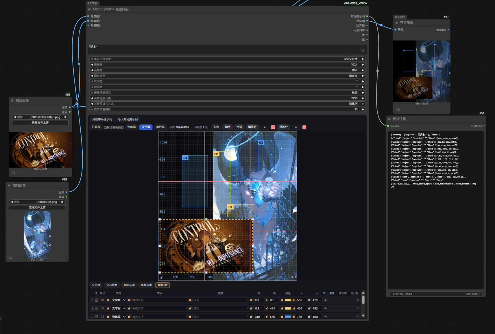

# MOSS YXBOX 控图排版

[](LICENSE)
[](https://github.com/liangci-ai/MOSS-YXBOX/releases)
[](https://github.com/liangci-ai/MOSS-YXBOX)
[](https://github.com/liangci-ai/MOSS-YXBOX/stargazers)
[](https://github.com/liangci-ai/MOSS-YXBOX/issues)



> **版本说明**：`main` 分支始终是**最新可用版**（= 最近一次 Release + 之后陆续的小修），小修复不会为此单独发版本号；GitHub 上的 tag / Release 是**里程碑快照**。想拿到最新修复，把节点更新到 `main` 即可（ComfyUI Manager 会提示）。

把 ComfyUI 官方的 **「Create Bounding Boxes / 创建边界框」** 与 **「MOSS-Image Layout Prompt / MOSS-Image 布局提示词」** 两个节点的能力，合到 **一个** 中文节点里，并做成一个更顺手的画布工作台：

- **一块画布**：物体框、文字框、角色框都画在同一块画布里，用画布上方的类型选择器决定「下一个画的框是什么类型」。
- **16 像素点阵 + 吸附**：画布是 16 像素点阵，画框 / 拖动 / 改尺寸都会吸附到 16 的倍数；缩放节点时网格会自动抽稀，不会糊成一片。
- **坐标系统**：把画布左下角当原点 (0, 0)，x 向右、y 向上，画布上标了刻度和三分线；每个框在列表里都能看到并直接改自己的左下角坐标。
- **逐行列表**：画布下方为每个框列一行，可直接改选中状态、类型、文字、描述、宽、高、主色、x、y；文字与描述各带一个「折叠三角」，点开就是一个够宽够高的大输入区。
- **锁**：每个参数前面有小锁，锁上之后这个参数在画布上和列表里都改不了（例如锁 x：框只能上下动，不能左右动）。
- **背景图（可多张）**：接入图片后自动当画布背景（压暗处理），列表底部为每张背景图单独列一行 `B1`、`B2`…，可以选中、拖动、缩放、重置，也可以调换背景图之间的上下层关系。
- **三种画布尺寸来源**：自定义输入 / 按接入图片宽高 / 按缩放后的图片宽高（与 LayerStyle 的「按宽高比缩放 V2」对应）。
- **布局提示词**：编译时直接调用官方 `MOSSImageLayoutPrompt` 的实现，输出格式与官方节点一致（0–1000 网格、中心原点像素、`yxyx`）。
- **导入 / 导出布局提示词**：画布区正上方两个按钮。导出＝把当前画布编译成的提示词原样显示出来（与节点输出逐字一致）；导入＝粘贴一段布局提示词（官方编译格式，或技能产出的草稿格式），直接还原成画布上的框与背景。
- 节点内的参数名与悬停说明都是中文。

## English overview

**MOSS YXBOX** merges ComfyUI's official **Create Bounding Boxes** and **MOSS-Image Layout Prompt** nodes into a single Chinese-language node with a full layout workbench: one canvas for object / text / character boxes, 16 px grid with snapping, per-box rows (type, text, description, w, h, color, x, y) with parameter locks, multiple background images layered under the boxes, three canvas-size modes, and import/export of the layout prompt. Output JSON matches the official node byte-for-byte (`abs_centralized` + `yxyx`).

Install: copy this folder to `ComfyUI/custom_nodes/MOSS_YXBOX`, restart ComfyUI, hard-refresh the browser. Requires a ComfyUI build that ships the MOSS-Image nodes.

---

## 一、安装

把本文件夹放到：

```
ComfyUI/custom_nodes/MOSS_YXBOX
```

最终结构：

```
MOSS_YXBOX/
├── __init__.py
├── nodes.py
├── pyproject.toml      # ComfyUI Registry / Manager 用
├── README.md
├── LICENSE
├── docs/
│   └── preview.png     # README 顶部那张截图
└── web/
    └── moss_yxbox.js
```

也可以用 Manager 或在 `custom_nodes` 里执行：

```bash
git clone https://github.com/liangci-ai/MOSS-YXBOX.git
```

（文件夹名保持 `MOSS-YXBOX` 或改成 `MOSS_YXBOX` 都行，**唯一的硬要求是名字里不能有空格**，原因见下面的提示。）

然后 **重启 ComfyUI**，浏览器里按 `Ctrl + F5` 硬刷新。

节点位置：右键菜单 → `MOSS` → **MOSS YXBOX 控图排版**。

> **文件夹名必须没有空格。** ComfyUI 用 `web.static('/extensions/' + 文件夹名, …)` 提供前端脚本；文件夹名带空格时这条静态路由会 404（实测：脚本出现在 `/extensions` 列表里，但请求返回 404），结果就是节点上既没有画布也没有类型选择器。所以目录叫 `MOSS_YXBOX`，节点显示名仍是中文的「MOSS YXBOX 控图排版」。

---

## 二、界面从上到下

```
┌──────────────────────────────────────────────────────────────┐
│ ○ 布局提示词输入                                                │  ← 接文本，实时导入（下面的说明见「布局提示词输入口」）
│ ○ 背景图1   ○ 背景图2 …（右侧还有 8 个背景图输入口，接满才全亮）│  ← 图像输入口
├──────────────────────────────────────────────────────────────┤
│ 画布尺寸来源 │ 画布宽 │ 画布高 │ 画布比例 │ 比例宽/高 │ 画布缩放基准 │ 画布缩放长度 │ 背景图填充方式 │ 宽高取整倍数 │
├──────────────────────────────────────────────────────────────┤
│ 整体描述（MOSS 的 prompt；右下角两条小斜杠可上下拖动改高度）      │  ← 参数下方、按钮上方
├──────────────────────────────────────────────────────────────┤
│ [导出布局提示词] [导入布局提示词] [保存节点预设] [管理与加载预设]     │  ← 画布区正上方
├──────────────────────────────────────────────────────────────┤
│ 只画框  当前绘制框类型：[物体框] [文字框] [角色框]  画布 1536×1536  背景图 2 张  多选 网格 坐标 横等分〔3〕竖等分〔3〕 │
├──────────────────────────────────────────────────────────────┤
│                                                              │
│        画布（16 点阵 + 三分线 + 等分线 + 坐标刻度 + 框 + 背景图）│
│                                                              │
├──────────────────────────────────────────────────────────────┤
│ 全选框  全选背景  删除选中  隐藏选中  撤销  重做                  │
├──────────────────────────────────────────────────────────────┤
│ ☑ 编号  类型  文字  描述  宽  高  颜色  x  y  显示 重置 作画布 锁 删除 │  ← 表头，与下面的行逐列对齐
├──────────────────────────────────────────────────────────────┤
│ ☰ ☑ 01  🔓[类型▾] 🔓[文字]🔻 🔓[描述]🔻 宽 高 色 x y 👁 ─ ✕   │
│ ☰ ☑ 02  🔓[类型▾] 🔓[文字]🔻 🔓[描述]🔻 宽 高 色 x y 👁 ─ ✕   │
│ ☰ ☑ B1  [背景图]        🔓[描述]🔻 宽 高    x y 👁 重置 ✕     │  ← 每张背景图一行，永远在最底部
└──────────────────────────────────────────────────────────────┘
```

表头与下面的行使用同一套盒模型（同样的 `padding`、`border`、`box-sizing`）和同一个 24 列网格，所以每一列的标题都正对着下面那一列的内容；列宽按内容放宽过，「作画布」「选中」这类标题不会再被截断，个别窄列若仍显示省略号，鼠标停在标题上会浮出完整说明。

列表区**至少留出 10 行**的高度（约 340 px）：不超过 10 行时列表按实际行数长，不铺空白；**超过 10 行才在列表区内部出现上下滚动条**（表头固定在顶部，不跟着滚）。上限同时受窗口高度 42% 约束，把节点拉高还能一次看到更多行。列表高度由布局自动分配（内容多就在这块固定空间里滚动），所以拖动节点边缘缩放时不会出现高度反复跳动。

### 导入 / 导出布局提示词（画布区正上方两个按钮）

| 按钮 | 作用 |
| --- | --- |
| 导出布局提示词 | 弹窗显示节点**最终会输出的那段布局提示词**（与后端编译结果逐字一致，含 `summary` / `items` / `bbox_coord_space` / `bbox_format`），只读，点「复制」即可拿走。没有画任何框时，导出的是「整体描述」原文，和节点输出一致。 |
| 导入布局提示词 | 弹窗粘贴一段内容，点「导入」就能还原画布。三种内容都认：①草稿（`items` 里是 `x/y/width/height`，左上角原点）；②编译后的布局 JSON（`bbox_coord_space: abs_centralized` + `bbox_format: yxyx`，中心原点）；③纯描述文字（只写进「整体描述」）。带 ```` ```json ```` 代码块、带前后说明的整段 LLM 回答也能直接粘。草稿的元素列表除了 `items`，也认 `compositional_deconstruction.elements`、`elements`、`boxes`；描述除了 `summary.caption` / `caption`，也认 `high_level_description` / `description`；草稿里没写 `width/height` 时，就按所有 `bbox` 的最大范围推断画布大小。 |

导入时的行为：

- 草稿带 `width/height`、编译 JSON 带 `width/height` 时，画布会跟着改成这个尺寸（并把「画布尺寸来源」切到「自定义尺寸」）。
- 有框超出现有画布时，会弹一次确认：**确定**＝按内容把画布放大到刚好装下所有框（并对齐 16 的倍数），**取消**＝保持当前画布（超出部分被裁掉）。
- 每一项的 `label`（`text` / `character` / `object`）会还原成「文字框 / 角色框 / 物体框」，`text`、`caption`、`palette`（或 `color_palette`）一并还原；`items` 是从背景到前景排列，导入后列表顺序会倒过来，保证「列表越靠上＝画面越上层」不变。
- 导入算一步操作，可以按「撤销」回到导入前的画布。

### 布局提示词输入口（实时导入）

节点左侧**最上面那个输入口**（在「背景图1」上方）叫 `布局提示词输入`，接一段 STRING 文本就行：

- 接上就自动导入，**不用点按钮、不用执行**：和「导入布局提示词」认同三种内容（草稿 / 编译 JSON / 纯描述），把描述、框、类型、文字、颜色一起铺到画布上。
- **实时跟随**：上游文本框里改一个字、删一段、整段清空，画布立刻跟着变（比如接一个文本节点，一边打字一边看框怎么动）。**把上游文本删光，画布会回到什么都没画的初始状态**（框、选择、整体描述一起清掉），不会残留在上一次的内容上。
- 优先读上游节点里**名字像文本**的控件（`text` / `string` / `prompt` / `value` / 文本 / 文字 / 描述 / 提示词），没有这类名字时取最长的那条字符串；都读不到才退到它的 STRING 输出。
- **按当前画布换算**：草稿里的 `width/height`、编译 JSON 里的 0–1000 网格，都会等比换算到你**当前**的画布尺寸上，而且**不会反过来改你的画布尺寸**（画布宽高仍然由「画布尺寸来源」那几个参数说了算）。这样同一段提示词换到 1536 或 1024 的画布上都对。
- 上游文本没变时不会重复导入，所以你在画布上手动微调过的框不会被冲掉；只有上游文本真的变了才会重新覆盖。
- 断开这个输入口后就不再跟随，画布保持断开时的样子。

> 想「固定住」某个版本，接一个只读文本节点，或者先导入、再把线断开即可。

### 节点预设（保存 / 管理）

| 按钮 | 作用 |
| --- | --- |
| 保存节点预设 | 小弹窗里填一个名字（**可以留空**，留空时自动按 `1`、`2`、`3`… 取第一个没被用过的编号），点「保存」就把当前节点的**全部状态**存下来：画布尺寸来源与宽高、比例、缩放参数、取整倍数、背景图填充方式、所有绘制框（类型/文字/描述/宽高/坐标/颜色/锁/隐藏）、所有背景图行的尺寸与位置、整体描述。弹窗里还有一个「连同背景图一起保存」勾选项（默认勾上）：勾上会把背景图输入口上那张图的文件名/子目录/类型一起存下来，下次加载时**自动按这个信息把图重新接到输入口**，不用你再手动接一次；如果文件已经不在了，只有背景图这一步会失败（弹窗里提示「加载背景图失败」），其它参数照常恢复。 |
| 管理与加载预设 | 弹窗里是已保存的全部预设，可以搜索名字、按名称/创建日期（升/降序）或自定义顺序排列、自选每行显示几个。结构支持**最多 3 级文件夹**：可新建文件夹、点文件夹名进去、重命名、删除（整个文件夹连里面的预设一起删，需要二次确认）。预设和文件夹都能单选/多选（有「多选」「全选」开关）；选中后点「加载选中」把预设应用到当前节点，「重命名」「移动到」（换文件夹）、「上移 / 下移」（自定义顺序下调整顺序）、「删除选中」（需二次确认）都在同一排按钮里。 |

预设保存在浏览器本地（`localStorage`），所以同一个浏览器、同一个地址下一直有效；换浏览器、清缓存、换端口会看不到（这点和 ComfyUI 自带的设置一样）。

---

## 三、画布上的操作

| 操作 | 结果 |
| --- | --- |
| 在空白处按下并拖动 | 画一个新框（宽高自动吸附 16 的倍数），松手即选中 |
| 只画框 | 在「当前绘制框类型」左边的开关。打开后画布上**只认画新框**：点/拖在已有框内部也是新建（可以做嵌套框），选中、拖动、缩放、双击改字、右键菜单、Delete 全部让路；想调整已有框时关掉即可。开关状态只是临时模式，不随工作流保存 |
| 按住 Shift 或 Alt 拖动 | 不管「只画框」开没开，**强制在按下处画新框**（在已有框内部也能画），松手后恢复原状。适合偶尔嵌套一次，不想切开关 |
| 在已有框上按下并拖动 | 移动这个框；如果同时选中了多个框，则一起移动 |
| 单击一个框 | 选中它；如果打开了「多选」，再单击另一个框就是加选，再单击已选中的框则取消选中 |
| 拖动选中对象的 8 个控制点 | 四个角 + 四条边的中点，共 8 个白色小方块：拖角改两个方向、拖边只改一个方向（吸 16 的倍数）；鼠标移到不同控制点上会变成对应的缩放光标 |
| 双击框 | 就在**这个框里面**直接输入文字 / 描述（输入框与框完全重合） |
| 双击后点框外任意位置 | 提交并退出输入 |
| 双击背景图 | 在这张背景图**没有被框、也没有被上层背景图盖住**的地方双击，就直接选中这张背景图 |
| 画布上方的三个类型按钮 | 决定「下一个画的框」是物体框 / 文字框 / 角色框；当前类型按钮亮成该类型的颜色 |
| 多选 | **多选总开关**（在「网格 / 坐标」左边）。关闭时，画布上点一下、列表里勾一下都只会选中一个对象；打开后才能同时选中多个、一起拖动 |
| 网格 | 显示 / 隐藏 16 像素点阵与网格线 |
| 坐标 | 显示 / 隐藏坐标刻度、坐标轴与三分线（1/3、2/3 处的黄色虚线） |
| 横等分 / 竖等分 | 各自独立开关。点一下打开，按右边数字（2–20）画等分线：横向等分画 `n-1` 条横线、竖向等分画 `n-1` 条竖线；改数字立刻重画。数字后面还有一个**颜色块**，点开可以单独改这个方向的等分线颜色（默认淡红色 `#ff8a8a`、实线） |
| 全选框 | 点一下选中所有绘制框（不含背景图），按钮变成「取消全选框」，再点一下取消全选 |
| 全选背景 | 点一下选中所有背景图，按钮变成「取消全选背景」，再点一下取消全选 |
| 删除选中 | 删除所有选中的框和背景图，**点两次**才生效（第一次变红显示「确认?」） |
| 隐藏选中 | 点一下把选中的对象全部隐藏，按钮变成「取消隐藏选中」，再点一下把它们恢复显示 |
| 撤销 | 橙色描边的按键，**点一下往回退一步**：从打开工作流算起，本节点里的每一次操作（画框、拖动、缩放、改宽高/坐标/文字/描述/颜色/类型、显示隐藏、删除、排序、复制粘贴、画布尺寸变化、背景图互换等）都算一步。按钮上的数字就是还能退几步；退到头时按钮变灰不可点。最多保留 60 步（更早的自动丢掉），并且**打开工作流后历史从头开始**，不会把上次保存的操作带进来 |
| 重做 | 在「撤销」右边，样式完全一样。撤销之后可以把它**再走回来**（按钮上的数字是还能重做几步）。一旦你在撤销后又动了画布，重做记录就作废，从新操作重新开始 |
| 在画布上滚鼠标滚轮 | **放大查看**（以鼠标所在位置为中心，**100%–800%**）。最小就是 100%（画布正好铺满、居中），不能再缩小。只改显示，不动任何框的坐标和尺寸，导出的 JSON 也不受影响 |
| 按住鼠标右键拖动 | 放大之后**平移画布**看别处，拖动时鼠标变成小手；100% 时没有可平移的空间。松开就停；**右键单击不动弹**仍然是原来那个右键菜单（删除 / 颜色 / 类型） |

缩放 / 平移之后画布右下角会出现一个「缩放 xx%」的小角标，**点一下回到 100% 并居中**。

鼠标指针：

- 没选中东西、或正在画新框时：**十字**（不带箭头）。
- 选中某个框 / 背景图之后，鼠标落在它里面：**移动箭头**。
- 落在它 8 个控制点上：对应的缩放箭头。
- 打开了「只画框」：画布上**一律是十字**（不给选中、缩放光标）。

规则：

- **再点一下取消选中**：不论「多选」开没开都生效——点在一个已选中的对象上、不拖动，就把它取消选中。
- 多选开关管的是「能不能同时选中多个」：关闭时（默认）点另一个对象会把前面的取消，打开后是加选。
- 框不能拖出画布：`x + 宽 ≤ 画布宽`、`y + 高 ≤ 画布高`，改尺寸时若超出会自动往里收。
- **画布外面什么都不显示**：超出画布范围的框、控制点、背景图都会被画布边界切掉（背景图可以先伸到画布外，但伸出去的部分不显示）。
- 颜色规则：框的主色就是「颜色」那一列的色块；没设主色时按类型配色（物体框蓝、文字框红、角色框绿、背景图灰）。
- 背景图可以比画布大：多出来的部分被裁掉不显示；比画布小时可自由摆放（拖出画布的部分同样不显示）。

### 右键菜单、键盘删除与复制粘贴

在**画布内点鼠标右键**，会弹出一个小菜单（作用于当前选中的对象，单个或多个都行）：

| 菜单项 | 作用 |
|---|---|
| 删除选中（点两次） | 第一次点变成「确认删除 N 个?」，再点一次才真的删掉，避免误删 |
| 复制选中框（Ctrl+C） | 把选中的绘制框复制到节点的内部剪贴板（背景图不参与复制） |
| 粘贴框（Ctrl+V） | 把剪贴板里的框贴回画布，位置往右下挪 16px、自动压在画布范围内，贴完自动选中新框；剪贴板空着时这一项会提示「剪贴板是空的」 |
| 自定义颜色 | 8 个预设色块 + 一个取色器，点了立刻把选中的框都改成这个颜色（等价于改「颜色」那一列的主色） |
| 修改框类型 | 物体框 / 文字框 / 角色框，一键把选中的框都改成这个类型 |

说明：

- 右键点在**没被选中的对象**上，会先把它选中再弹菜单；点在空白处、当前又没有选中任何东西时不弹菜单。
- 选中里**只要有一张背景图**，就不显示「自定义颜色」「修改框类型」——这两个功能只对绘制框有效。
- 已经上锁的参数（类型锁、颜色锁）不会被菜单改动。
- 键盘 **Delete**（或 **Backspace**）可以删除选中（单个或多个），和工具条按钮共用一套「两次确认」：第一次按只是进入确认态（工具条上的按钮会变成红色的「确认删除?」），3 秒内再按一次才真正删除；鼠标停在输入框里打字时按 Delete 不会误删。
- 键盘 **Ctrl+C / Ctrl+V** 复制粘贴选中的框，作用和右键菜单里的同名项完全一样；焦点在输入框里时按这两个键仍然是普通的文字复制粘贴。
- 这些快捷键只在**鼠标停在本节点上**时生效，离开节点后 Delete 仍然交回 ComfyUI（删节点），不会抢操作。

---

## 四、列表行的操作

每行从左到右：

| 列 | 作用 |
| --- | --- |
| ☰ | 按住可以上下拖动排序：拖动时**被拖的那行变半透明，一条蓝色横线指示会插到哪个位置**，松手才落位（这样列表不会跟着鼠标整块重排，拖起来更跟手）。列表越靠上的框 = 画面里越上层，编译成 items 时顺序会倒过来；背景图也是同一套拖动排序，但背景图整体永远在绘制框下面 |
| ☑ | 是否选中（和画布上的点击完全同步；没开「多选」时勾一个就只选这一个） |
| 编号 | 显示 `01`、`02`…；背景图显示 `B1`、`B2`… |
| 🔓 类型 | 下拉框，随时改框类型 |
| 🔓 文字 | 文字框的框内文字（其它类型不用填） |
| 🔓 描述 | 给这个框的画面描述，会作为 MOSS 的 `caption` |
| 🔓 宽 / 高 | 直接输入像素值（仍是 16 的倍数） |
| 🔓 颜色 | 主色，会写进布局提示词的 `palette` |
| 🔓 x / y | 框左下角在画布里的坐标（左下角为原点，y 向上为正），改的时候自动夹在画布内 |
| 👁 | 显示 / 隐藏这一行（隐藏的框不参与预览图，也不进布局提示词；隐藏的背景图不再画出来） |
| 重置 | **只有背景图行有**：把这张图按它的原始尺寸放回画布（超过画布的部分自然伸到画布外、不显示），之后仍然可以拖拽缩放 |
| ✕ | 删除这一行。**需要点两次**：第一次变红显示「确认?」，再点一次才真正删除，避免误删 |

**折叠三角**：文字、描述这两个输入框的右边各有一个小三角；点开后会在**这一行下方**展开一大块输入区（足够宽、足够高，方便写长句），两个折叠区各自独立开合、互不影响。再点一次三角收起。

**锁**：类型、文字、描述、宽、高、颜色、x、y 每一项前面都有一个小锁。

- 点一下锁上（图标变实心），该参数在**画布上和列表里都改不了**，输入框也会变灰。
- 例：锁住 `x` 之后，框只能上下（y 方向）拖动，左右拖不动；锁住 `宽` 之后，拖左右两侧的控制点只改位置、不改宽，拖上下两侧的只改高。
- 再点一下解锁即可恢复编辑。

---

## 五、背景图（可多张）

- 节点最左边一开始只有一个「背景图1」输入口。接入一张图后，会自动再多出「背景图2」，可以继续接；最多 8 张。
- **接上就显示**：图一接进输入口，画布上立刻出现背景，不用先执行一次（上游是「加载图像」时直接按它的图像参数取图；上游是其它图像节点时，会在它执行完后自动轮询到结果并补上）。
- **初始摆放**：保持原图长宽比，缩到刚好填满画布的一条边（画布比例与原图一致时就是正好铺满），不超出画布，左下角对齐画布原点。
- 接进来的图会先做背景化处理（压暗），所以画布上看到的就是最终背景。
- 每张背景图在列表底部有自己的一行（`B1`、`B2`…），有独立的编号、描述、宽、高、x、y、显示、重置、作画布、锁、删除。
- **背景图区域内可以直接画框**：在背景图内部按下拖动＝画新框；想选中 / 移动背景图，点它**贴边的一圈**，或者在列表里点它的编号 / 勾选框。
- **「作画布」**（列表里每张背景图都有）：点一次变成「确认?」，再点一次才生效。生效后画布尺寸＝这张图的原始尺寸（按取整倍数取最近值），图片铺满画布并**整体锁定**（不能拖动、缩放，但仍可在上面画框）；要恢复拖动/缩放，点同行最后的「锁」列图标解锁。
- 图层关系：**所有背景图永远在所有绘制框的最底层**；背景图之间的上下层关系由它们在列表里的顺序决定（越靠上越上层），拖动 ☰ 就能调。
- 断开某个背景图输入口，对应那一行会自动从列表里撤掉。

---

## 六、三种画布尺寸来源

「画布尺寸来源」下拉框：

| 模式 | 行为 |
| --- | --- |
| `自定义尺寸` | 画布尺寸 = 你填的「画布宽 / 画布高」，接不接图都不变；接了图片也会被当作背景铺进画布 |
| `按图片原始尺寸` | 画布尺寸 = 接入图片的原始宽高，再各自取**最接近的 16 的倍数**（例如 1600×900 → 1600×896），图片同时按这个尺寸铺满画布 |
| `按缩放规则计算` | 先按下面一组参数算出"缩放后的图片尺寸"，再用它当画布尺寸（也是 16 的倍数），背景图按算出来的尺寸铺 |

`按缩放规则计算` 用到的参数（与 LayerStyle 的「按宽高比缩放 V2」一一对应）：

| 本节点参数 | LayerStyle 对应 | 说明 |
| --- | --- | --- |
| 画布比例 | 比例 | `保持原图`、`自定义`、`1:1`、`5:4`、`4:3`、`3:2`、`16:9`、`2:1`、`21:9`、`4:5`、`3:4`、`2:3`、`9:16`、`1:2` |
| 比例宽 / 比例高 | 比例宽 / 比例高 | 选 `自定义` 时才生效 |
| 画布缩放基准 | 缩放模式 | `长边`、`短边`、`宽度`、`高度`、`总像素(千像素)`、`不缩放` |
| 画布缩放长度 | 缩放长度 | 目标边长（或目标总像素，按基准而定） |
| 背景图填充方式 | —— | `填充`、`留白`、`裁切`、`锁比例`（拖任意控制点缩放背景图时，长宽始终按原图比例同步变化；列表里手改宽/高也会带着另一方向等比变） |
| 宽高取整倍数 | —— | `16`（默认）、`8`、`32`、`64`、`128`、`256`、`无`；算出来的宽高都会取最近的这个倍数 |

举例：接一张 1600×900 的图，
- `按图片原始尺寸` → 1600×896（900 取最近的 16 倍数是 896）；
- `按缩放规则计算` + 长边 1024 → 1024×576；
- `按缩放规则计算` + 比例 `2:1` + 短边 512 → 1024×512。

> 画布的宽高与背景图的宽高是**两套独立设置**：画布尺寸来源只决定画布多大，不会重新摆放你已经拖好的背景图；背景图的大小用列表里那一行的「宽 / 高」或「重置」来管。

> 想让背景图始终不变形，把「背景图填充方式」切到 `锁比例`：之后不管拖哪个控制点（拖角、拖边中点都一样），宽高都会按原图比例一起变；在列表里手改宽或高，另一个方向也会跟着等比调整。锁住 `宽` 时比例以宽为准反推高，锁住 `高` 时以高为准反推宽。

### 默认值（新建节点时）

| 参数 | 默认值 |
| --- | --- |
| 画布尺寸来源 | `自定义尺寸` |
| 画布宽 / 画布高 | `1536` / `1536` |
| 画布比例 | `自定义` |
| 比例宽 / 比例高 | `1` / `1` |
| 画布缩放基准 | `长边` |
| 画布缩放长度 | `1536` |
| 背景图填充方式 | `锁比例` |
| 宽高取整倍数 | `16` |

> 每个参数鼠标悬停都有中文说明（多行的用法、三种模式的差别都写在里面）。

---

## 七、输出

节点右侧有 6 个输出：

| 输出 | 内容 |
| --- | --- |
| `布局提示词` | 官方 MOSS-Image 的布局 JSON 字符串（接 MOSS 的 prompt 输入） |
| `预览图` | 按画布尺寸渲染的预览（框 + 编号 + 描述 + 背景图） |
| `边界框` | 官方格式的框数据（`BOUNDING_BOX`） |
| `元素列表` | 官方格式的元素数组（`ARRAY`） |
| `宽` / `高` | 最终画布尺寸，方便接到别的节点 |

布局提示词的格式与官方 `MOSSImageLayoutPrompt` 完全一致：

```json
{
  "summary": {"caption": "一张海报", "meta": ["poster"]},
  "items": [
    {"label": "text", "caption": "粗黑无衬线大标题，居中", "text": "MOSS YXBOX",
     "palette": ["#FF3B30"], "bbox": [-473, -452, -291, 449]}
  ],
  "bbox_coord_space": "abs_centralized",
  "bbox_format": "yxyx"
}
```

- `bbox` 是**中心原点**的像素坐标 `[y0, x0, y1, x1]`；左上角用 `floor`、右下角用 `ceil`。
- 隐藏的框、背景图那几行都不会出现在 `items` 里。
- 没有框时，直接输出「整体描述」原文。

「画布数据」是隐藏参数，存的是画布内容的 JSON（框、背景图、尺寸模式、锁、显示状态等），工作流保存时会一并存下来，不需要手动改。

---

## 八、和官方两个节点的对应关系

| 官方节点 | 本节点 |
| --- | --- |
| Create Bounding Boxes 的 `background` | 背景图（输入口）→ 同时作为画布背景（可多张） |
| Create Bounding Boxes 的 `bboxes` | 不再需要上游给框，直接在画布上画 |
| Create Bounding Boxes 的 `width` / `height` | 画布宽 / 画布高（多了三种尺寸来源） |
| Create Bounding Boxes 的 `editor_state` | 画布数据（隐藏参数） |
| Create Bounding Boxes 的 `preview` / `bboxes` / `elements` | 预览图 / 边界框 / 元素列表 |
| MOSS-Image Layout Prompt 的 `prompt` | 整体描述 |
| MOSS-Image Layout Prompt 的 `element` | 元素列表（不用接，内部已算好） |
| MOSS-Image Layout Prompt 的 `width` / `height` | 画布宽 / 画布高 |
| MOSS-Image Layout Prompt 的 `character_boxes` | 不用填：类型选了「角色框」的框会自动被识别成角色 |

---

## 九、已知限制

- 复制粘贴只在**本节点内部**有效（不走系统剪贴板），不能跨节点或跨 ComfyUI 页面；背景图不参与复制。
- 右键菜单只作用于「当前选中的对象」，不能对没选中的对象直接操作。
- 「按缩放规则计算」只影响画布与背景尺寸，不会真的缩放输出图片（预览图仍是纯绘图）。
- 隐藏的框仍保留在列表里，只是不参与输出。
- 「重置」只对背景图有效（绘制框的尺寸请直接改宽高）。
- 「撤销 / 重做」历史最长 60 步，且只记录打开工作流之后的操作，重新打开就从头开始。
- 背景图最多 8 张（`背景图1`…`背景图8`），这是节点的输入口上限。

---

## 十、更新记录

### v1.0.2 之后的修复（在 main 上，随更新获得）

- 修「鼠标滚轮无法缩放画布」：把滚轮监听从画布的冒泡阶段改到 `window` 的**捕获阶段**——ComfyUI 自己也会处理滚轮（缩放整个画布视图），它比画布先拿到事件，之前会被前端先吃掉；现在先由我们处理并阻止继续冒泡。鼠标在列表、输入框、画布以外滚动时一律不接管（列表照常滚动、图照常缩放）。
- 修「画布放大后再缩放工作流视图，画布内容会位移」：节点被工作流缩放时会被套上 CSS transform，`getBoundingClientRect()` 给的是**视觉像素**、`clientWidth/Height` 才是**布局像素**。之前画布用前者算几何，视图一缩放（但画布自己的缩放比例没变）内容就整体偏移。现在画布内的一切坐标、鼠标换算、右键菜单定位、平移量都统一用布局像素，并按视觉像素给足背板分辨率（上限 4096），任何视图缩放下都清晰且不位移。

### v1.0.2

- 画布支持**滚轮放大**（100%–800%，以鼠标位置为中心）与**右键拖动平移**（100% 时不可平移）；右下角「缩放 xx%」角标点一下回到 100%。缩放只影响显示，不改任何框的坐标，导出的 JSON 也不受影响。
- 缩放手柄改成**四角 + 四边中点共 8 个控制点**，拖哪个方向就只改那个方向（拖角同时改宽高、拖边只改一条边）；鼠标悬停会变对应方向的光标。
- 新增**横等分 / 竖等分**参考线（可设条数），每条后面带一个小色块可单独改颜色。
- 「全选」「全选背景」「隐藏选中」改成**开关式**：再点一次就取消；「隐藏选中」可反向恢复。
- 列表行支持**拖拽排序**（☰ 按住上下拖）：按住时只有被拖的那一行跟手，其它行一次算好位置，不再每帧重排。
- 画布右键菜单：删除选中（二次确认）、改自定义颜色、改框类型（物体 / 文字 / 角色）；键盘 `Delete` / `Backspace` 同样可删。
- 每个参数（宽、高、颜色、x、y）前面都有一个**小锁**：锁上后画布上拖不动也改不了、列表里输入框置灰，再点一次解锁。
- 新增画布**坐标轴**（左下角为原点，x 向右、y 向上）与每条框的 x / y 坐标显示与编辑，坐标自动钳制在画布内。

- 第一次加载节点时按画布尺寸自动给出一个能看全的初始大小（默认 1024×1024 时约 980×1012），画布、工具条、列表全部一次可见。
- 兼容 ComfyUI 的 Nodes 2.0 开关：两套前端下列表高度都由节点自己算好（不再依赖前端压缩），画完一个框立刻就能看到那一行。
- 坐标轴原点只标一个 `0`（之前左下角 `x` 轴和 `y` 轴各标一个 0，叠成一个 `00`）。
- 背景图接入后**不用执行节点，画布立刻显示**：上游是「加载图像」时按它的图像参数直接取图，其它图像节点则轮询上游输出，一执行完就自动补上。
- 新增「保存节点预设」「管理与加载预设」两个按钮：可保存/加载节点全部参数与画面内容，预设可分组（最多 3 级文件夹）、搜索、多选、改名、排序、删除。
- 界面微调：列表行悬停高亮、表头吸顶、控件圆角与间距统一。
- 列表区高度改为「实测工具条 + 10 行表格」硬预算，并给节点尺寸加了兜底自增：就算前端给的空间比内容小，节点也会自己补高，工具条和列表不会再被裁掉半行。
- 初始尺寸改成「刚好够用」：列表按实际行数长高（上限 10 行，超过才滚动），加载时就回收旧工作流里存下的超高尺寸，不会一打开就是一大条。
- 顶部「整体描述」改成**节点自己的 DOM 输入框**（照 VMNodes 海报工作台的做法）：位置在参数区（宽高取整倍数）下方、四个功能按钮上方；**右下角那两条小斜杠就是拖拽手柄**，按住上下拖只改这个框自己的高度（64px 起，最高 1200px），文字超出框高就在框内滚动。
- 高度记在节点属性里（`node.properties.yxProseH`），重开工作流还在；你拖高它时如果节点不够高，节点会自动补到刚够，**但绝不会自动把你拉大的节点压矮**。
- 修「单击一下描述框就长一点 / 缩一点」：量高度改用 CSS 布局像素（`offsetHeight`），不再用会带上画布缩放倍率的 `getBoundingClientRect()`；并且只在你**从输入框上按下**的那次松开才量，普通单击完全不碰它。
- 参数说明重写：每个参数的中文提示都补上了「什么时候生效、其它参数怎么配合、每个选项什么意思」（尤其「画布尺寸来源」的三种模式、「画布缩放基准」的六种口径）。
- 默认值调整：画布 1536×1536、画布比例「自定义」、比例 1:1、缩放基准「长边」、缩放长度 1536、背景图填充方式「锁比例」。
- 新增 `布局提示词输入` 输入口（在「背景图1」上方）：接一段 STRING 就自动按「导入布局提示词」的规则铺好画布，上游文本一变画布实时跟着变，并按当前画布等比换算。
- 修「上游文本框里删改内容，节点没反应」：现在改成优先读上游节点自己的文本控件（再退到它的 STRING 输出），**把文本删光会让画布回到初始状态**（框、选择、整体描述一起清掉），不再保留上一次的内容。
- 导入解析兼容更多草稿写法：元素列表也认 `compositional_deconstruction.elements` / `elements` / `boxes`，描述也认 `high_level_description` / `description`；草稿没写 `width/height` 时按 bbox 最大范围推断画布。
- 导入解析更宽容：`width/height` 写在 `canvas` 对象里也认，`type`（而不是 `label`）也能识别框类型。
- 原生「整体描述」控件在界面上隐藏，只负责存值与序列化：老工作流里存的文字照常读进新输入框，导出/编译仍取同一个值。
- 节点高度**只由你自己决定**：插件只在「工作流里没存过尺寸（默认小方块）」时撑一次到刚好够用，之后任何情况下都不会自动改高度。
- 列表列宽改为按比例分配：缩放节点时所有列一起等比变宽，不再只有「文字 / 描述」两列变宽、其余列一直被截断；表头的「选中 / 显示 / 删除」等短列也加宽到能完整显示。
- 新增「重做」按键（在「撤销」右边，样式一致，最多 60 步）；撤销后又动了画布时重做记录自动作废。
- 新增框的复制粘贴：`Ctrl+C` / `Ctrl+V`，或者画布右键菜单里的「复制选中框 / 粘贴框」；粘贴会往右下挪 16px、自动压在画布内并选中新框。
- 修 `Delete` 键不生效：改成在窗口 capture 阶段接管，`Delete` 和 `Backspace` 都能删（仍是两次确认）；只有鼠标停在本节点上时才接管，离开节点后 Delete 照旧交给 ComfyUI 删节点。
- 修 `布局提示词输入` 接口出现两个重叠小圆点 / 接入点消失：恢复成 ComfyUI 标准的 `forceInput`（只留一个带名字的接入点、不生成文本控件），不再用「隐藏控件」的做法——那种做法在 Nodes 2.0 开启时会把接入点整个藏掉，关闭时又会剩一个没名字的小点压在「背景图1」上。

### v1.0.1

- 列表区至少显示 **10 行**，超过 10 行才出现滚动条（之前窗口矮的时候只能看到两三行）。
- README 补上截图、徽章、安装结构和更新记录。
- 增加 `pyproject.toml`（ComfyUI Registry / Manager 可搜到）、Issue 模板。

### v1.0.0

- 首个公开版本。

---

## 十一、反馈

- Bug / 功能建议：<https://github.com/liangci-ai/MOSS-YXBOX/issues>
- 反馈时请附上：插件版本、ComfyUI 版本、复现步骤、浏览器控制台报错、截图（Issue 模板里都列好了）。
